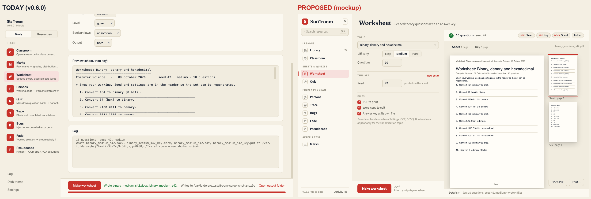
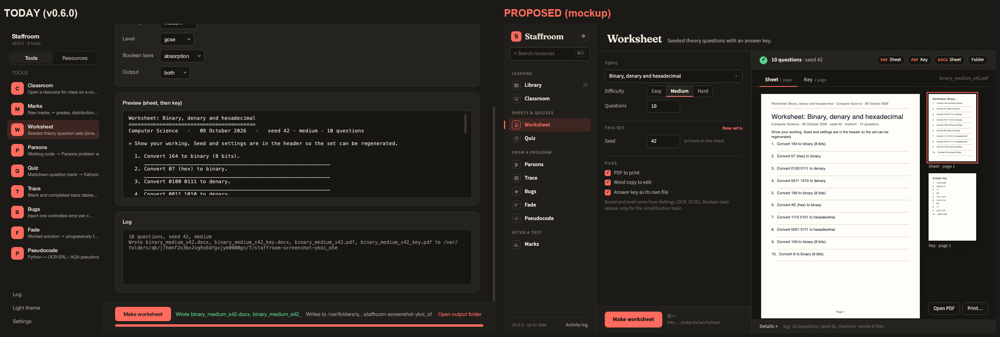
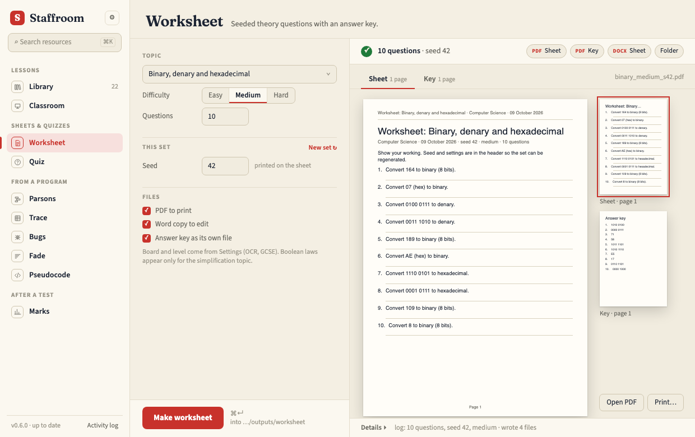
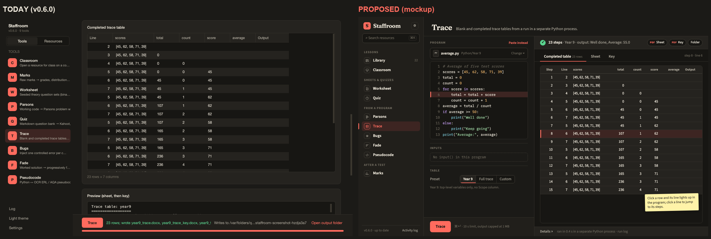
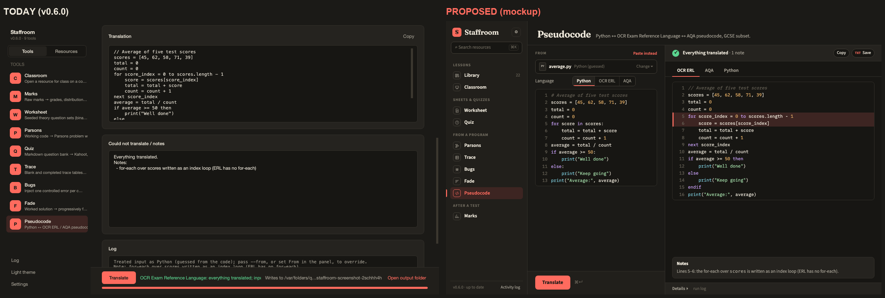
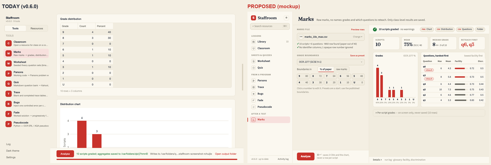
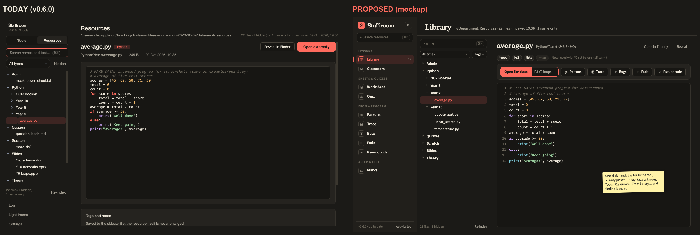
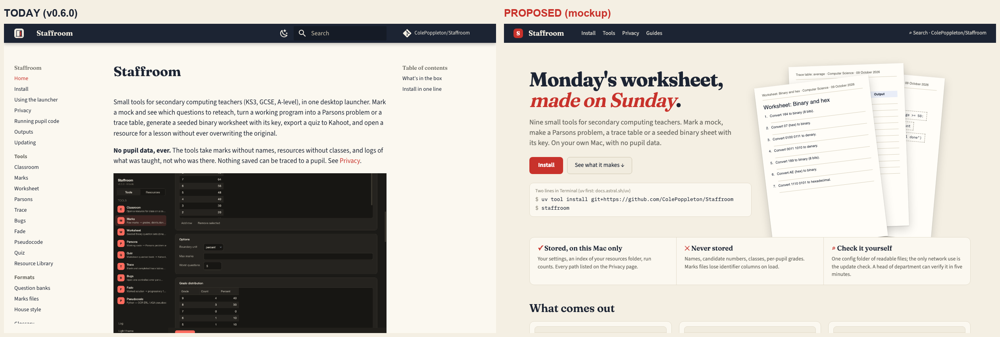

# Audit 2026-10-09 — before Phase 9

Run at `799001a` (v0.6.0, `origin/dev`) in a clean worktree with a throwaway home
(`STAFFROOM_HOME=data/audit/home`) whose config points at an invented resources root
(`data/audit/resources`: the screenshot fixtures plus 17 more invented `# FAKE DATA` files, no
names). Nothing here read or touched the owner's config, sessions or resources. Scratch evidence
is under `data/audit/` (git-ignored): `cli_output.txt` and `cli_output2.txt` (every CLI run
verbatim), `shots/` (54 launcher renders: every section, both themes, plus full-height renders),
`probe_layout.py` / `probe_layout.txt` (panel measurements), `out/` (files the tools wrote).
Everything this file cites as an image is committed beside it in [`2026-10-09/`](2026-10-09/).

This audit builds on [2026-10-08](2026-10-08.md). That one found bugs and trust gaps and its
23 issues are all closed (v0.4.0–v0.6.0). It allowed one bounded redesign (print layout). This
one does the new section 1b of the skill — a design pass over every section of the app — and
that pass is where most of the findings are.

## 0. Purpose check

*A UK secondary computing teacher's weekly workflow, on their own machine, outputs carried into
school by hand, with no pupil data anywhere.*

The product does what it says, and v0.4–v0.6 closed the gaps the last audit found (§2.5). The
suite is green (`uv run pytest -q`: exit 0, no failures, 22 skipped). What it does not yet do is
let the teacher **see the work while they make it**: in seven of nine tools the result starts
below the fold, every run scrolls the inputs away, the sheets are previewed as ASCII art, and
the library cannot hand a file to a tool. Those are design costs paid every week, and no bug hunt
would find them.

## 1. What was run

| Area | Commands / renders |
| --- | --- |
| Environment | `uv sync`; `uv run pytest -q` (exit 0); `staff version` (0.6.0); `staff list` (9 visible, hello hidden) |
| Library | `staff library index` (23 files, 1 name only, 2.0 s), `status`, `search while` (9 matches) |
| Marks | `run` on `marks_10x_max.csv`, `marks_messy.csv` (3 warnings), a fixture with a `Name` column (dropped), `notes.txt` (polite refusal, exit 1); `presets` |
| Worksheet | `topics`; `make --topic binary --seed 7` and `--seed 42`; `--topic truth_tables --difficulty hard` |
| Parsons | `make` on `year9.py`, a tab-indented file, an empty file |
| Trace | `make` on `year9.py`; a program calling `input()` with no inputs (exit 1, clear message); `while True: pass` (stopped at 10 s) |
| Bugs, Fade | `bugs make year9.py`; `fade make year9.py`; fade on a syntax error (refused) |
| Pseudocode | `to-ocr`, `to-aqa` on `year9.py` |
| Quiz | `check`; `export -f donow`; `export -f kahoot`; `retrieval` with `taught_log.csv` |
| Classroom | `open … --label "P3 Y9 loops"`; `list` |
| Shell | `staff usage`; `staff update --check` |
| Launcher | `staffroom --screenshot` for: first run, Settings, Library (empty, `.py`, `.pptx`), every tool empty and after `--run`, both themes, at 1240×780; full-height renders at 1240×4200; `probe_layout.py` measures each panel offscreen (cards, fields, content height, where the first result sits) |
| Docs site | `mkdocs build`; landing page rendered with headless Chrome at 1240×780 and full height, both schemes; PyPI lookup for `staffroom` |

Panel measurements (`data/audit/probe_layout.txt`, viewport 702 px under the run bar):

| Tool | Input fields | Height before run | Height after run | Screens after run | First result at y |
| --- | ---: | ---: | ---: | ---: | ---: |
| classroom | 4 | 1162 | 1162 | 1.7 | 382 |
| marks | 6 | 1664 | 3626 | **5.2** | **1372** |
| worksheet | 9 | 1015 | 1015 | 1.4 | 471 |
| parsons | 10 | 1341 | 1341 | 1.9 | 813 |
| quiz | 12 | 1367 | 1806 | 2.6 | 795 |
| trace | 15 | 1674 | 2273 | 3.2 | 1114 |
| bugs | 15 | 1665 | 1924 | 2.7 | 1105 |
| fade | 9 | 1340 | 1340 | 1.9 | 796 |
| pseudocode | 8 | 1651 | 1651 | 2.4 | 779 |

## 2. Persona findings (section 1)

Format: `[area] what happened → what the persona expected → evidence → severity`.

### 2.1 The colleague, first time, no instructions

- **F1 [docs, install]** The docs home page says *Install in one line: `uv tool install
  staffroom`*. There is no such package: `https://pypi.org/pypi/staffroom/json` → 404 and `echo
  staffroom | uv pip compile -` → "staffroom was not found in the package registry". The working
  GitHub line is in a note further down the Install page. → Expected: the first command on the
  site works. → Evidence: `current-docs-home-*.png`, the commands above. → **blocks** (and if
  anyone registers the name, the site tells teachers to install a stranger's package).
- **F2 [classroom]** The run bar says *Writes to …/outputs* and *Open output folder*, but
  *Open for class* copies into the sessions folder (`staff classroom open` → `Copied:
  …/home/sessions/2026-10-09/P3 Y9 loops/average.py`). → Expected: the folder named is the one
  used. → Evidence: [`current-classroom-dark.png`](2026-10-09/current-classroom-dark.png). →
  **hurts**.
- **F4 [library]** Found `average.py` in Resources, wanted to open it for a lesson: the preview
  offers *Open externally* and *Reveal in Finder* only. Getting it into Classroom takes 8 actions
  (select → Tools tab → Classroom → From library… → find it again → Choose → label → Open for
  class). → Expected: "use this" from where it was found. → Evidence:
  [`current-library-py-dark.png`](2026-10-09/current-library-py-dark.png). → **hurts** (design
  finding, see R6).
- **F5 [sidebar]** All nine tool descriptions are truncated in the sidebar, two without an
  ellipsis ("Working code → Parsons problem w", "Python ↔ OCR ERL / AQA pseudocc"); nine identical
  red badges, two of them "P". → Evidence: every launcher screenshot. → **annoys** (R7).
- Good: the first-run card asks one question, can be skipped, and states what is stored.

### 2.2 The owner, Sunday night, 40 minutes

- **F3 [quiz]** Made a do-now (`export -f donow`), then a retrieval starter (`retrieval -l
  taught_log.csv`): both write `question_bank_donow.{pdf,docx}` and `_key`, so the second silently
  replaced the first (folder listing in `cli_output2.txt`). → Expected: two different sheets keep
  two names. → **hurts**.
- **F6 [marks]** After *Analyse*, the panel is 3,626 px (5.2 screens): the mean and median are
  never shown; the "Worst questions" card repeats rows of the per-question table; the
  distribution table (10 rows, 6 of them zero) repeats the chart. → Evidence:
  [`current-marks-run-full-light.png`](2026-10-09/current-marks-run-full-light.png). → **hurts**
  (R5).
- **F7 [all sheet tools]** The preview of a worksheet, Parsons, trace, bugs or fade sheet is a
  monospace text rendering — Parsons blocks as `+- 1 ---+` boxes clipped at the right, sheet and
  key in one scroll box. To check page breaks before printing the owner opens Finder and Preview.
  → Evidence: [`current-parsons-run-dark.png`](2026-10-09/current-parsons-run-dark.png),
  [`current-worksheet-run-dark.png`](2026-10-09/current-worksheet-run-dark.png). → **hurts** (R3).
- **F8 [run bar]** The success status is truncated in all eight after-run screenshots ("Wrote
  binary_medium_s42.docx, binary_medium_s42_"), sits beside a second label repeating the folder,
  and the files can only be reached through *Open output folder*. → **annoys** (R2).
- Good: marks' three warnings on the messy file are exact and in plain words; marks refuses
  `notes.txt` politely (exit 1); presets list cleanly; worksheet answers checked by hand (seed 7
  and 42 binary) are right.

### 2.3 The head of department: "where does pupil data go?"

- No regression. `marks_namecol.csv` → "Dropped identifier column(s), never used: Name"; saved
  outputs are three aggregate files. The library indexed `Admin/mock_cover_sheet.txt` by name only
  and says why in `staff library status`. Settings › Resources states what is stored, in words.
- **F9 [usage]** `staff usage` counted two `staffroom --screenshot --run` renders as launcher runs
  (`marks 6 run(s) launcher 2`), although screenshot mode sets `config.read_only`; `classroom
  list` also counts as a run. Harmless for privacy, but it skews the usage review PHASES.md uses
  to decide what to keep. → Evidence: `cli_output.txt` (usage), `shell/worker.py` calls
  `record_run` unconditionally. → **polish** (#93).
- The landing page's privacy promise is one sentence; the HoD wants the proof on the page they
  are sent to (R8).

### 2.4 The trainee, weak Python

- **T1 [bugs]** Default run on `year9.py`: 2 of 4 variants are "no visible change (still runs
  the same)" (`>= 50` → `> 50` and `>= 51` with an average of 55). The sheet does not warn that
  running the program will not reveal them. → Evidence: `cli_output.txt` (bugs). → **annoys** (#92).
- **T2 [trace]** The completed table lists line numbers (2, 3, 4, 5, 6, 7, 5, 6 …) with the
  program nowhere on screen: the panel never shows the chosen file's code, and the paste box stays
  empty when a file is picked. → Evidence:
  [`current-trace-run-dark.png`](2026-10-09/current-trace-run-dark.png). → **hurts** (R4).
- **T3 [options]** Worksheet shows *Boolean laws: absorption* for the binary topic; quiz shows
  12 fields including *As of (YYYY-MM-DD)* with retrieval off; choices read `bottom_up`, `gcse`,
  `both`. → Evidence: [`current-worksheet-dark.png`](2026-10-09/current-worksheet-dark.png),
  [`current-quiz-dark.png`](2026-10-09/current-quiz-dark.png). → **annoys** (#91).
- Good: missing `input()` lines and infinite loops are explained in one sentence; fade refuses
  invalid Python; the pseudocode notes explain the for-each rewrite.

### 2.5 The good list (must survive any redesign)

Everything on the [2026-10-08 good list](2026-10-08.md#25-the-good-list-must-survive-any-redesign)
still holds, plus what Phase 8 added and this audit re-checked:

1. Identifier columns dropped once, in `core/csvio`, for every table including quiz's taught log;
   marks saves aggregates only; per-script grades labelled view-only.
2. Every tool has a CLI twin and a panel built from one spec; tools never import Qt.
3. Teacher-worded refusals: wrong file type, missing inputs, invalid Python, a 10 s loop.
4. One output folder, shown before a run (the redesigns keep it, in the strip).
5. Library name-only rule for files that look like pupil details, exclusions, and the "what is
   stored" statement in Settings and the first-run card.
6. Sheets that print well: Parsons and bugs layouts from #22; seeds printed; keys split off.
7. Classroom never touches the original; promote never overwrites and spots unchanged copies.
8. Both themes readable; the manila / navy / red-pen palette is distinctive and should stay.

## 1b. Design pass (section 1b)

Each section: task flow, hierarchy, structure, density, consistency, and what a well-made app a
teacher already uses does. Verdict per section: **redesign** (with mockup) or **fine** (with the
reason). Mockups are standalone HTML using the tokens in `core/theme_tokens.py` and the brand
type (Fraunces, Source Sans 3, IBM Plex Mono), rendered at 1240×780 in both themes; open any
`mock-*.html` with `?theme=light`. Each `compare-*.png` puts today on the left and the proposal
on the right.

### Sidebar and navigation — redesign (R7)

- *Task flow.* Pick a tool: one click, fine. Find the library: a Tools/Resources toggle that
  swaps the whole sidebar, so a tool and the library are never visible together.
- *Hierarchy.* The eye lands on a column of nine identical red squares. The red-pen accent is
  used 13 times on the Classroom screen (badges, version chip, *From library…*, *Open for class*,
  *Open output folder*), so the primary action is one red thing among many.
- *Structure.* A flat list. A teacher's week has shapes: things for this lesson (library,
  classroom), sheets and quizzes, things made from a program (five tools share that input), and
  after a test (marks).
- *Density.* Every description is truncated; a second line of noise per tool.
- *Consistency.* Theme toggle in two places; `--settings` leaves the last tool highlighted; the
  docs site uses the brand type, the app uses the system font.
- *What a good product does.* Apple Notes / Mail: grouped sources, monochrome glyphs, accent only
  on selection; Things: one line per item, counts on the right.

#### R7 Sidebar and identity

Brand row (mark, *Staffroom* in Fraunces, a settings gear), a library search field (⌘K), then
four groups: **Lessons** (Library, Classroom), **Sheets & quizzes** (Worksheet, Quiz), **From a
program** (Parsons, Trace, Bugs, Fade, Pseudocode), **After a test** (Marks). One line per tool
with a monochrome glyph; the accent only on the selected item, primary buttons, links and focus.
Footer: version and update state, *Activity log*. Fraunces / Source Sans 3 / IBM Plex Mono
bundled (OFL) so the app and the site are one product. Version chips and the sidebar theme toggle
go. Saves: finding a tool by shape and group instead of reading nine red letters; one red thing
per screen. Risks: ⌘1–⌘9 order changes; fonts add ~1 MB to the package. Every mockup in this
audit shows the proposed sidebar.

### Tool panels

Verdict: **redesign** (R1, R2, R3, R4, plus #91 for the options forms).

- *Task flow.* Worksheet: choose topic → (scroll) → Make → auto-scrolled to a text preview; change
  the seed → scroll up → Make → scrolled down again. Trace: pick file (code not shown) → scroll →
  Trace → a 23-row table of line numbers with no code beside it.
- *Hierarchy.* Inputs and outputs have the same weight (identical cards in one column). The
  result — the reason for the visit — starts below the fold in 7 of 9 tools (table in §1).
- *Structure.* Organised by widget type, one card per spec entry: "Python file" and "Or paste
  code" are two cards for one input in five tools; an Options card renders every dataclass field,
  relevant or not (#91); a Log card in every panel duplicates the status line and the log drawer.
- *Density.* A permanent ~180 px Log card; 8–12-row empty paste boxes; the result strip truncated.
- *Consistency.* Sibling tools are consistent with each other — consistently stacked. Classroom's
  run bar names the wrong folder (F2).
- *What a good product does.* Thonny's debugger and Python Tutor show code beside the variable
  table with the current line lit; Preview and Pages show the page, not a text dump; Kahoot's
  creator keeps the editor and the preview side by side.

#### R1 Workbench

Inputs pane on the left (≈390 px, own scroll, hairline groups not cards, primary action pinned at
its foot with ⌘↵), output pane on the right (tabs when there is more than one main view). Nothing
auto-scrolls; results never push inputs away. Saves: a scroll per iteration; first result visible
in 9/9 tools instead of 2/9. Risks: narrower inputs at the 1040 px minimum (inputs pane narrows to
340 px); every panel's screenshots change; ActionTable panels (classroom) need a sensible place
for the session list (below the main output). Measure: the probe in §1 as a shell test.

#### R2 Result strip

At the top of the output pane: tick or cross, a short outcome, one chip per file written (opens in
its app), a Folder chip; warnings as an expandable count; the run log behind a one-line *Details*.
Removes the per-panel Log card and the duplicate "Writes to" label. Saves ~180 px per panel, and
Finder for every file opened. Risk: a teacher who relied on the log card's text finds it one
click away. Shown in the worksheet and marks mockups.

#### R3 Page preview

`PagePreview` renders the PDF that was just written with `PySide6.QtPdf` (already installed, no
new dependency): current page large, thumbnails for sheet and key, *Open PDF*, *Print…*. Replaces
the ASCII previews in worksheet, parsons, trace, bugs, fade and quiz do-now. Saves: the
Finder → Preview check before printing. Risk: render time for long sheets (lazy thumbnails).

#### R4 Code source

One `CodeSource` input for the five code tools: a source chip (file, library path, *Change ▾*,
*Paste instead*) over a read-only, highlighted code view with line numbers. Trace links rows and
lines both ways; pseudocode becomes the side-by-side panes its own spec asked for. Not an editor
(see not doing). Saves: the duplicate card, and the trainee's "which line is 6?".

### Run bar and results area — redesign (folded into R1 and R2)

The run bar's button, status and folder belong to the inputs pane (button) and the result strip
(status, files, folder). No separate redesign; covered by #83 and #84.

### Marks — redesign (R5)

#### R5 Marks report

- *Task flow.* Pick file → read an 11-row preview → scroll past boundaries and options → Analyse →
  scroll through five result cards. 5.2 screens to answer "how did they do, what do I reteach?".
- *Structure.* Built around widgets (table, chart, table, table, table) instead of the question.
- *What a good product does.* A report card / dashboard: headline numbers, one chart, one table.

Proposal: file chip with a load summary instead of the preview table; boundaries as a compact
grid; output pane with four tiles (scripts, mean %, median grade, reteach first), the chart with
counts and % under the bars, **one** per-question table sorted hardest first with an inline
facility bar and reteach marks, per-script grades collapsed and still labelled never saved.
Saves: 5.2 screens → 1; the mean and median the owner works out by hand today. Risk: the
distribution table and "worst" card disappear as cards (the CSVs keep their content).

### Resource Library — redesign (R6)

#### R6 Library: use it

- *Task flow.* 8 actions to open a found file for class (F4); same detour for Parsons or Trace.
- *Hierarchy.* The biggest button is *Open externally*; tags and notes sit below the fold.
- *What a good product does.* Finder's Quick Look plus "Open With"; Google Drive's preview with
  the apps that can use the file across the top.

Proposal: the library is a sidebar destination; its page has tree + search in one column and the
preview beside it; under the title, tags as chips and a use bar: *Open for class* with an inline
label field, then one button per tool that accepts this file type, built from the tools' own
input specs. Saves: 8 actions → 3. Risk: a second route into classroom must go through the same
plugin `run` so the original is still never touched.

### Settings — fine, no redesign

Visited a few times a year. Eight titled cards on one page, each saving as it changes, with the
"what is stored" statement where the HoD will look. The text is long but it is the privacy
statement and should be. The only costs found are covered elsewhere: the duplicate theme toggle
and the sidebar not highlighting Settings under `--settings` (both in #89), and #74's locked-home
saves. Evidence: [`current-settings-dark.png`](2026-10-09/current-settings-dark.png).

### First run — fine, no redesign

One decision (choose the resources folder), skippable, with the sessions folder and the stored
data stated. A colleague can also ignore it and use the tools. Nothing to fix beyond fonts (#89).
Evidence: [`current-firstrun-dark.png`](2026-10-09/current-firstrun-dark.png).

### Classroom panel — covered by R1, R2 and F2

The task (pick resource, label, open) is short; its costs are the shared ones (stacked cards, an
empty Diff card taking space before any session exists, a Log card) plus F2. Under R1 the inputs
pane holds resource and label; the output pane holds today's sessions with the diff of the
selected one. No separate mockup.

### Printed sheets — fine for now

The PDFs use Helvetica and pale-blue table headers rather than the brand, but they print cleanly,
the Parsons and bugs layouts were fixed in #22, and nobody reads a worksheet for its typography. Recorded, not scheduled.

### Docs site landing page — redesign (R8)

#### R8 Docs landing

- *Hierarchy.* Above the fold: a small dark screenshot of the marks panel scrolled to the middle
  of the boundaries table. The teacher's question ("what will I get?") is answered nowhere on the
  page: no output page is shown.
- *Structure.* Text table of tools; install line that fails (F1); privacy in one sentence; nav
  mixes teacher guides with Process, Roadmap and Audits.
- *What a good product does.* Product pages that lead with the artefact (Notion's templates,
  Canva's gallery): show the page, then how to get it.

Proposal: headline, two sentences, *Install* + the two working lines; a fan of real output pages;
a three-column privacy strip (stored / never stored / check it yourself); a *What comes out*
gallery made by `just screenshots`.

## 3. Decisions (the PM meeting)

Theme for Phase 9: **The workbench** — results beside the inputs, pages instead of text, files a
teacher can open from where they look; and the three bugs a colleague hits first.

| # | Issue | Finding | Value | Cost | Risk | Verdict |
| --- | --- | --- | --- | --- | --- | --- |
| 1 | #80 | F1 install line fails | Every new colleague, day one; supply-chain risk | S | None; owner decides on PyPI | **now** |
| 2 | #81 | F2 classroom names the wrong folder | Every lesson opened | S | Small spec addition | **now** |
| 3 | #82 | F3 quiz overwrites the do-now | Owner weekly | S | File names change: Outputs guide | **now** |
| 4 | #83 | R1 workbench layout | Every run of every tool | M | All screenshots change; min-width fit | **now** (redesign) |
| 5 | #84 | R2 result strip, F8 | Every run | M | Log one click away | **now** (redesign) |
| 6 | #85 | R3 page preview, F7 | Every sheet made (6 tools) | M | Render time; QtPdf on CI | **now** (redesign) |
| 7 | #86 | R4 code source, T2 | 5 tools, trainee most | M | Must not grow into an editor | **now** (redesign) |
| 8 | #87 | R5 marks report, F6 | Every mock | M | Aggregate-only saving must stay tested | **now** (redesign) |
| 9 | #88 | R6 library use bar, F4 | Every lesson prep | M | Second route to classroom must reuse its run | **now** (redesign) |
| 10 | #89 | R7 sidebar and identity, F5 | Every visit; brand one product | M | Bundled fonts (OFL), ordering, shortcuts | **now** (redesign) |
| 11 | #90 | R8 docs landing | Every colleague and HoD who is sent a link | S | Claims must match the privacy page | **now** (redesign) |
| 12 | #91 | T3 options show irrelevant fields | Trainee, colleague | M | Vocabulary change; do with #62 | next |
| 13 | #92 | T1 bugs "no visible change" by default | Trainee | S | None | next |
| 14 | #62 | Pseudocode From follows the file | Trainee | S | Builds on #91/#86 | next (kept) |
| 15 | #74 | Locked config home saves | Rare setups | S | Marks presets (#87) | next (kept) |
| 16 | #26 | Kahoot import check | Owner only | S | Needs the owner: **blocked** | next (kept) |
| 17 | #79 | Launcher install in place | Owner only | S | Packaging | next (owner's, kept) |
| 18 | #93 | F9 usage counts renders and listings | Owner's usage review | S | None | later |
| 19 | #94 | Classroom "edited" time and wording | Owner | S | None | later |

Order of work: #80, #81, #82 (small, independent), then #83, then #84–#87 on top of it in any
order; #88, #89, #90 are independent of #83 and can run in parallel sessions. Eleven `now` issues:
eight of them redesigns, because that is what the design pass found; none is a nudge.

How we will know it is better: the §1 probe as a shell test (first result visible in 9/9 tools;
marks ≤ 1 screen), the 8 → 3 action count for library → class, before/after screenshots of every
section in both themes, and the landing page's install line run in CI.

## 4. Not doing (and why)

| Proposal | Reason |
| --- | --- |
| Redesign Settings | Fine (§1b): rarely visited, every card saves on change, the long text is the privacy statement. Its two real costs are in #89 and #74. |
| Redesign the first-run card | Fine (§1b): one skippable decision, states what is stored. |
| Re-run automatically on every option change ("live preview") | Trace, bugs and others run a subprocess per run (10 s limit); a run per keystroke is waste and noise. Run stays explicit with ⌘↵; the workbench makes re-running one key. |
| Let CodeSource edit and save files | Thonny is the editor; classroom solves overwriting. CodeSource shows code and accepts a paste, nothing more. |
| A web / Electron / Tauri rewrite to get the workbench | Everything proposed is plain Qt; PDF rendering is in PySide6 already (`QtPdf`). |
| A home dashboard with "recent outputs" | A new persistent store with no evidence it is needed; the strip's file chips and Folder chip cover "where did it go". |
| User-reorderable sidebar, favourites, hiding tools | Nine tools fit in four groups; no evidence anyone wants to reorder. |
| Restyling the printed sheets in the brand | Fine for now (§1b): they print cleanly; typography on paper is not costing the teacher time. |
| Publishing to PyPI as part of #80 | The owner's decision (account, name ownership). #80 only makes the docs truthful either way. |

Earlier refusals in [2026-10-08 §4](2026-10-08.md#4-not-doing-and-why-so-it-is-not-re-proposed)
stand (pupil-data features, cloud, accounts, AI questions, a real sandbox, YAML banks…). Its line
"Rewriting the shell as a web app … no measured failure" is answered here: the failure is now
measured (§1 table), and the answer is still Qt, restructured.

## 5. Reconciliation with the board

- Open before this audit: #26, #62, #74 (Phase 8, `next`) and #79 (owner, no milestone). All
  four were checked against this audit and kept: none duplicates a new issue. All moved to the
  Phase 9 milestone at `priority:next`; #26 relabelled `status:blocked` (only the owner can import
  into Kahoot); comments link #62 to #91/#86 and #74 to #87.
- Phase 8 milestone: 0 open, 29 closed → closed.
- Created #80–#94: #80–#90 `priority:now`, #91–#92 `priority:next` under **Phase 9: The
  workbench**; #93–#94 `priority:later` with no milestone. All `status:ready` + `audit`. Redesign
  issues carry their mockups and the structural-change line; #84–#87 note they build on #83, #90
  on #80.
