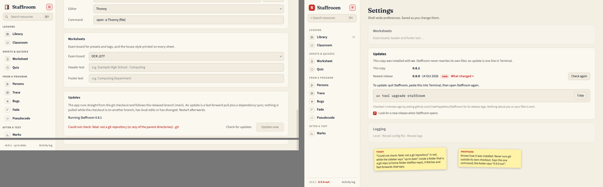
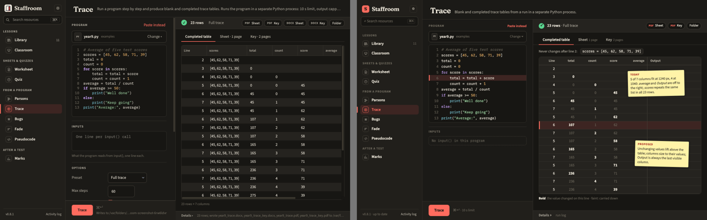
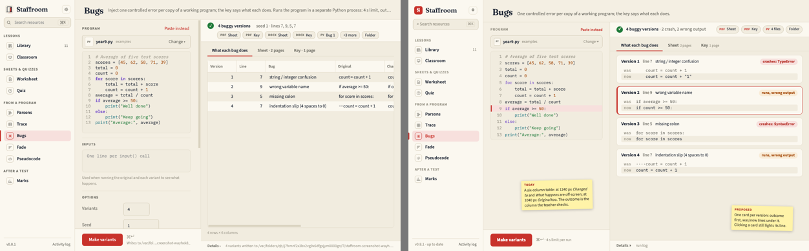
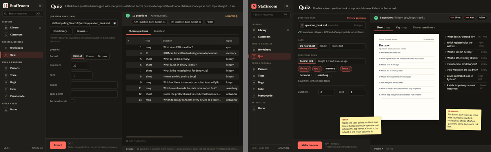
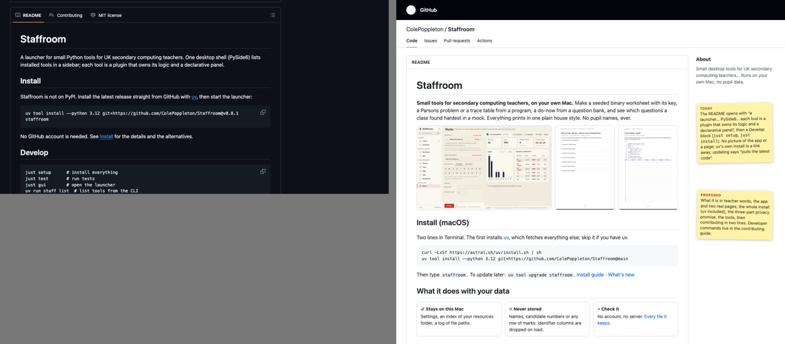
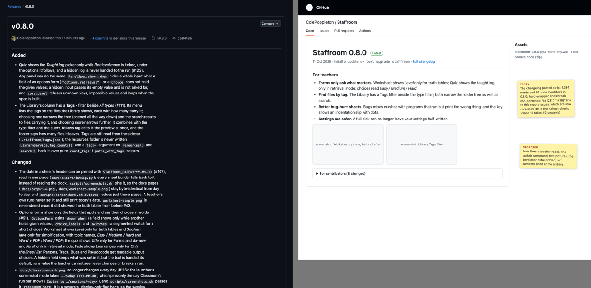

# Audit 2026-10-11 — before Phase 10

Run at `a21ef49` (v0.8.1, `origin/dev`, the first commit of the public repository) in a clean
worktree. Every app run used a throwaway `STAFFROOM_HOME` under `data/audit/` whose config points
at an invented resources root (the screenshot fixtures plus a few more invented files, no names).
The two install walks used throwaway `UV_TOOL_DIR`, `UV_TOOL_BIN_DIR`, `UV_PYTHON_INSTALL_DIR` and
`STAFFROOM_HOME`; the contributor walk cloned into a scratch folder. Nothing read or touched the
owner's config, sessions or resources, the main checkout or the installed launcher. Scratch
evidence is under `data/audit/` (git-ignored): `cli_output.txt`, `cli_quiz.txt`, `logs/`
(install, contributor, probes), `shots/` (57 launcher renders, the live site and GitHub pages),
`probes/` (`probe_update.py`, `probe_tables.py`), `mock/` (mockup builders). Everything this file
shows as an image is committed beside it in [`2026-10-11/`](2026-10-11/).

This audit builds on [2026-10-08](2026-10-08.md) (bugs and trust; 23 issues, all closed) and
[2026-10-09](2026-10-09.md) (the design pass; Phase 9 built all eight redesigns, R1–R8, in
v0.7.0, and v0.8.0–v0.8.1 closed the rest). What changed since is the audience: the repository
went public, so two new personas join the four fixed ones — a colleague installing from the
public docs on a clean Mac, and an outside contributor — and the public face (README, the docs
site, release notes, the repository page) is judged as a product too.

## 0. Purpose check

*A UK secondary computing teacher's weekly workflow, on their own machine, outputs carried into
school by hand, with no pupil data anywhere.*

The app itself holds up. The suite is green (`just check` in a fresh clone: 1,173 passed, 22
skipped; lint and both import contracts kept), the hard rule is still enforced in one place, and
every Phase 9 redesign is in and working (§2.6). The failures this time are almost all at the
edge where the app meets a stranger's Mac and a stranger's browser: the canonical install
(`uv tool install`) behaves like a git checkout it is not, it weighs 1.4 GB, and the public pages
still speak to the one person who built it. One of those failures is serious: an installed copy
treats whatever git repository happens to enclose it as "this checkout", and `staff update`
fast-forwards that repository (§2.1, P1).

## 1. What was run

| Area | Commands / renders |
| --- | --- |
| Environment | `uv sync`; `QT_QPA_PLATFORM=offscreen uv run pytest` (exit 0); `just lint` (ruff, format, mypy, `lint-imports`: 2 kept) |
| Install, git line | `uv tool install --python 3.12 git+https://github.com/ColePoppleton/Staffroom@v0.8.1` with throwaway tool, bin and Python dirs (43 s with a warm package cache, Python 3.12.13 downloaded, 16.9 MiB); `du -sh` of the tool env; `staff --help / version / list / update --check / usage` |
| Install, wheel | `gh release download v0.8.1 -p '*.whl'`, `uv tool install --python 3.12 ./staffroom-0.8.1-py3-none-any.whl` (outside any repository, and inside an invented home-folder git repository with its own remote); `staff update --check`, `staff update`; `probe_update.py` (a real start, waits for the startup update check, grabs Settings) |
| Install weight | `uv pip install --target … pyside6-essentials==6.12.0 pyside6-pdf==6.12.0.140` and `du -sh`; `grep` of every `PySide6.*` import in `src/` |
| Contributor | `git clone` into a scratch folder; `just setup`; `just gui --screenshot`; `just check`; `just new reading_age`; `staff list`; `staff reading_age run examples/marks_10x.csv`; `git add -A && git commit` (pre-commit hooks) |
| Tools (CLI) | `library index/status/search`; `marks run` on `marks_10x_max.csv`, `marks_messy.csv`, a `Name`-column fixture, a 250 × 25 fixture, `notes.txt`; `worksheet topics/make` (binary, hard truth tables, Huffman — answers checked by hand); `parsons make` on `year9.py`, a tab-indented file, an A-level file (class, try, with), a 1,501-line file, an empty file; `trace make` on `year9.py`, an `input()` program with and without `--stdin`, `while True: pass`, a print flood, the A-level file; `bugs make` on three programs; `fade make` incl. a syntax error; `pseudocode to-ocr / to-aqa`; `quiz check / export (donow, kahoot, forms) / retrieval / list`; `classroom open / list`; `hello run`; `usage` |
| Launcher | `staffroom --screenshot` for first run, welcome, Settings (and full height), the Library (`.py`, `.pptx`, root), every tool empty and after `--run`, failures (wrong file, missing input, a loop), both themes at 1240×780, four at the 1040×680 minimum; `probe_tables.py` (how many columns of each results table fit in the output pane) |
| Public face | `mkdocs build --strict`; headless Chrome renders of the live site (home, Install, Contributing, Adding a tool, Changelog, Privacy, Launcher, Worksheet), the GitHub repository page, the v0.8.0 and v0.4.0 release pages, *New issue*; `gh repo view`, `gh release view`, `gh label list`; `grep` of `docs/`, README and `.github/` for internal-workflow words |

## 2. Persona findings (section 1)

Format: `[area] what happened → what the persona expected → evidence → severity`.

### 2.1 A colleague installing from the public docs on a clean Mac (new persona)

Followed the Install page literally: the git line, then the wheel from the release.

- **P1 [update, installed copy]** An installed copy finds "its checkout" by walking up from
  `site-packages` (`core/paths.project_root()` is `Path(__file__).parents[3]`, which for a uv tool
  is `…/uv/tools/staffroom/lib/python3.12`; `git` then searches the parents). Outside any
  repository, Settings › Updates shows, in red, `Could not check: fatal: not a git repository (or
  any of the parent directories): .git` on every visit while the sidebar footer says
  `v0.8.1 · up to date`. Inside one — a home folder kept as a dotfiles repository is common — the
  app runs `git fetch` on **that** repository at every start, offers *Update now*, and `staff
  update` fast-forwarded it (`d52e0fe → 504ec86` in the invented home repo) and then crashed with a
  traceback from `uv sync` (`No pyproject.toml found`). → Expected: an installed app that never
  touches a repository it did not come from, and tells the teacher how to update. → Evidence:
  `logs/install-git-cli.txt`, the dotfiles transcript in this audit's run, `probe_update.py`
  output, [`current-updates-installed-light.png`](2026-10-11/current-updates-installed-light.png).
  → **blocks** (changes files outside the app; the docs' privacy line "the only network call is
  the update check, when the app runs from a git checkout" is not true for this case).
- **P2 [update]** The documented install pins a tag, so `uv tool upgrade staffroom` says *Nothing
  to upgrade*; the Updating page tells the colleague to visit Releases, copy the new tag and
  retype the install line. Nothing in the app tells them a release exists (P1). → Expected: one
  command, and the app saying when to run it. → Evidence: `docs/guide/updating.md`. → **hurts**.
- **P3 [install weight]** The tool environment is **1.4 GB**: `pyproject.toml` depends on the
  `pyside6` meta-package, which pulls PySide6-Addons and PySide6-WebEngine (645 MB of
  `QtWebEngineCore.framework` alone). The app imports only QtCore, QtGui, QtWidgets, QtSvg,
  QtPrintSupport (all in PySide6-Essentials) and QtPdf / QtPdfWidgets (PySide6-Pdf). Essentials +
  Pdf install to **368 MB**. → Expected: a small tools app to install quickly on school Wi-Fi and
  a 256 GB MacBook. → Evidence: `du -sh` (1.4G), `logs/essentials.txt` (368M), the import grep.
  → **hurts**.
- **P4 [docs]** The Install page says "this is the latest release, **v0.6.0**" directly above a
  line that installs v0.8.1 (`just release` re-pins the URL, not the sentence); the Updating page
  quotes v0.6.0 and v0.5.0; the docs screenshots show `v0.6.0` in the footer, and
  [`docs/settings.png`](../settings.png) shows the owner's worktree path
  (`…/Teaching-Tools-worktrees/feat/89-sidebar-identity/…`) and `/var/folders/…` temp paths.
  The Privacy page also carries "Upgrading from Teaching Tools" notes a colleague never needs.
  → Expected: one version everywhere and pictures without someone's folders in them. → Evidence:
  `curl …/guide/install/ | grep "latest release"` → `latest release, v0.6.0`; the PNGs.
  → **hurts** (distrust) / **annoys**.
- **P5 [CLI, installed copy]** `staff --help` offers `new` ("Scaffold a new tool package under
  src/staffroom/tools/") and `update` ("Compare this checkout…"); `staff new zzprobe` in the
  installed copy wrote a TODO tool into `site-packages` and it appeared in `staff list` and the
  launcher. Four commands are installed (`staff`, `staffroom`, `tt`, `tt-gui`): the `tt` aliases
  were "kept for one release" in v0.3.0, five releases ago. `update`'s and `usage`'s help text
  shows raw ``double backticks`` and hard line breaks. → **annoys**.
- Good: the first launch is calm and correct (one question, skippable, "~/TeachingSessions",
  what is stored), [`current-contrib-just-gui-dark.png`](2026-10-11/current-contrib-just-gui-dark.png);
  `uv` downloads Python 3.12 when the Mac has only 3.13; the wheel installs offline from the
  release asset; first run → a worksheet is three clicks.

### 2.2 An outside contributor (new persona)

Cloned into a scratch folder and followed the site's *How to contribute* page.

- **K1 [scaffold]** `just new reading_age` produces a tool whose first run, `staff reading_age run
  examples/marks_10x.csv`, writes **every row of the marks file back to disk** next to the input:
  `Wrote 10 rows to examples/marks_10x_reading_age.csv` — into the tracked `examples/` folder,
  which `git add -A` then stages. The template is `hello`, which does the same
  (`examples/marks_10x_totals.csv`). The hard rule says nothing per-row is ever written, and the
  scaffold teaches the opposite on a contributor's first minute. → Expected: a template that
  shows the rule (aggregate out, to the output folder). → Evidence: `logs/contrib-new.txt`.
  → **hurts**.
- **K2 [scaffold]** The scaffold is not lint-clean: the first `git commit` of a fresh scaffold is
  stopped by the ruff hook (`Found 1 error (1 fixed)`: an unused `# noqa: ANN201` on
  `panel_spec`). → **annoys**.
- **K3 [guide]** *Adding a tool*'s worked `run()` example writes `{stem}_graded.csv` (a grade per
  row) and says `summary=f"Graded {len(graded)} pupils"`; its panel example still lists the old
  `TablePreview` + `LogArea` pattern. → Expected: the guide's example to obey the rule the page
  above it states. → Evidence: `docs/adding-a-tool.md` §3–4. → **hurts** (it is what a newcomer
  copies).
- **K4 [guide]** *How a change gets in* says "Branch from `dev`" and "Open a pull request to `dev`"
  without saying an outside contributor forks first; it does not say `just gui` reads the real
  `~/.config/staffroom` (a contributor who is also a teacher points their own library at a dev
  build) or that `STAFFROOM_HOME` exists; `just check` takes about three minutes (2:57 here) and
  nothing says so. → **annoys**.
- **K5 [issues]** *New issue* offers one template, **Task — "A unit of work for the board"**, with
  `labels: status:ready`, so any outsider's report lands as ready work, and nothing warns a
  teacher not to attach a real marks file or markbook export. → Expected: a bug report and an
  idea form in teacher words, with the privacy warning. → Evidence: `.github/ISSUE_TEMPLATE/`,
  `shots/site/gh-newissue.png`. → **hurts** (the one new route by which real pupil data could
  enter the project is a helpful bug report).
- Good: clone 18 s, `.git` 39 MB, `just setup` and `just gui` work first time, `just check` green,
  the boundary tests and import contracts explain themselves, `staff list` shows the new tool at
  once, the page is short and states the rules first.

### 2.3 The public face (README, site, releases, repository)

- **W1 [README]** The repository's README — what a colleague sees when sent the GitHub link —
  opens "A launcher for small Python tools … One desktop shell (PySide6) lists installed tools in
  a sidebar; each tool is a plugin that owns its logic and a declarative panel", then *Develop*
  (`just setup`, `just install` "puts a thin launcher in /Applications that runs this checkout",
  `staff update` "pulls the latest code" — wrong for an installed copy, P1). No picture of the app
  or of a page, uv's own install a link away. → Evidence:
  [`current-github-readme.png`](2026-10-11/current-github-readme.png). → **hurts** (design, R4).
- **W2 [release notes]** Each GitHub Release is the changelog section pasted in. v0.8.0 is 1,334
  words with 51 code identifiers (`PanelSpec.shown_when`, `LibraryService.tag_counts()`,
  `core/atomic.py`); its hard-wrapped lines render as broken lines; v0.2.0's notes still list
  "the `/audit`, `/next-task` and `/merge-prs` skills" and ship `teaching_tools-0.2.0` wheels; the
  site's Changelog page lists "Phase 0 — Skeleton … Phase 7" and v0.8.1 says "the first audit no
  longer names the owner's real folder". → Expected: what changed for a teacher, in their words.
  → Evidence: [`current-release-080.png`](2026-10-11/current-release-080.png),
  [`current-site-changelog.png`](2026-10-11/current-site-changelog.png), `gh release view`.
  → **hurts** (design, R5) — and it exposes the internal workflow the owner asked to keep off
  the public face.
- **W3 [issue numbers]** The changelog and the release notes cite about 70 issue numbers from
  the private history (67 lines of `CHANGELOG.md`) (`(#123)`, `(#16)`…). On GitHub they now link to **this** repository's issues.
  v0.4.0's notes cite #10–#22: the Phase 10 issues this audit files will take exactly those
  numbers, so the old notes will point at unrelated new work. → **hurts** (gets worse with every
  issue filed).
- **W4 [privacy claim]** The home page's strip and the Privacy page say the only network call is
  the update check "when the app runs from a git checkout". P1 shows an installed copy calling
  `git fetch` on an unrelated repository. → **hurts** (HoD-relevant; fixed by P1, re-worded in
  the docs issue).
- Fine: the docs home page (R8) leads with real pages and the privacy strip; the nav puts
  teachers first; no page under `docs/` other than `audits/`, `ROADMAP.md` and `PHASES.md`
  (excluded from the build) mentions the audit, the skills or the board (`grep` → nothing but
  the issue template). `.claude/`, `CLAUDE.md` and `docs/audits/` stay in the repository, as the
  owner asked; nothing public links to them.

### 2.4 The owner, Sunday night, 40 minutes

- **O1 [quiz]** To make Monday's do-now from the bank, the owner opens the `.md` in another app to
  remember its topic tags, types them into a blank *Topics* field, switches *Format* from the
  default **Kahoot** (whose import has never been checked, #1) to *Do now*, and reads the chosen
  questions in a table where 3 of 6 columns fit (Topics, Spec and Answer off to the right). The
  bank picker is the old path field (`…Year 10 Quizzes/question_bank.md` truncated) while Marks
  and the code tools have chips. → Evidence:
  [`current-quiz-run-dark.png`](2026-10-11/current-quiz-run-dark.png), `probe_tables.txt`.
  → **hurts** (design, R3).
- **O2 [bugs]** After *Make variants*, the outcome of each bug — the thing to check before
  printing — is off-screen: at 1240 px `Changed to` and `What happens` are past the right edge,
  at 1040 px `Original` too. → Evidence: [`current-bugs-run-dark.png`](2026-10-11/current-bugs-run-dark.png),
  `probe_tables.txt`. → **hurts** (design, R2).
- Good: marks on the 250 × 25 fixture is still one screen with the reteach tiles; the three
  messy-file warnings are exact; `classroom open` copies and lists correctly; Library → Parsons in
  one click.

### 2.5 The head of department: "where does pupil data go?"

- No regression in what is stored: after the whole session the throwaway home holds
  `config.toml`, `library.db`, `usage.toml`, `logs/staffroom.log` (54 lines, the dropped column's
  *header* only) and one lesson copy; the marks outputs are the distribution, per-question CSVs and
  the chart; `Admin/mock_cover_sheet.txt` was indexed by name only.
- The two new risks are both from going public: an installed copy can run git against a
  repository the HoD never heard of (P1, W4), and the public issue tracker invites a teacher to
  attach the file that broke (K5). Both are scheduled.

### 2.6 The trainee, weak Python

- **T1 [parsons]** The default Parsons sheet from `year9.py` (seed 1) includes the distractor
  `scores = [45, 63, 58, 71, 39]` beside the real `scores = [45, 62, 58, 71, 39]`; seed 4 adds
  `count = count + 0`; a tab-indented file gets `total = 1` beside `total = 0`. The off-by-one
  mutation changes *any* integer, including data, and a pupil cannot know which list of scores
  is "right" from the sheet. The trainee cannot defend the key. → Evidence:
  [`current-parsons-run-dark.png`](2026-10-11/current-parsons-run-dark.png),
  `cli_output.txt` (parsons). → **hurts**.
- **T2 [trace]** The completed table repeats `scores = [45, 62, 58, 71, 39]` in all 23 rows and
  pushes `average` and `Output` (what the program printed) off to the right at 1240 px; at 1040
  px only `Line`, `scores`, `total`, `count` fit. On the A-level program 3 of 9 columns fit.
  → Evidence: [`current-trace-run-dark.png`](2026-10-11/current-trace-run-dark.png),
  [`current-trace-1040-dark.png`](2026-10-11/current-trace-1040-dark.png). → **hurts** (design, R2).
- **T3 [trace]** A program that asks for input with the Inputs box empty fails with a clear red
  line, but the output pane still says "Press Trace (⌘↵) and the result appears here", and the
  program's two `input()` calls could have been counted before running. The CLI says "the
  Inputs box is empty" (there is no box; it is `--stdin`). → Evidence:
  [`current-trace-missing-input-dark.png`](2026-10-11/current-trace-missing-input-dark.png).
  → **annoys**.
- Good: hand-checked Huffman (45 bits) and binary keys are right; the loop and print-flood
  programs stop at 10 s with one plain sentence; pseudocode lists `class`, `try`, `with` as not
  in the GCSE subset instead of dropping them.

### 2.7 The good list (must survive any redesign)

Everything on the [2026-10-09 good list](2026-10-09.md#25-the-good-list-must-survive-any-redesign)
still holds, plus what Phase 9 added and this audit re-checked:

1. The workbench: inputs left, result right, first result in view in 9 of 9 tools; nothing
   scrolls on its own; ⌘↵ runs.
2. The result strip: one line, a button per file, warnings as a count, the log one click away.
3. Real page previews with Sheet and Key tabs, *Open PDF*, *Print…*.
4. The shared code source with linked lines (trace and bugs rows ↔ program lines).
5. The marks report on one screen, aggregates only, per-script grades folded and labelled.
6. The Library's use bar: a found file to Classroom in three actions, to a tool in one.
7. The sidebar grouped by a teacher's week, one red thing per screen, the brand type.
8. A calm first run and a docs home page that leads with real pages.
9. Identifier columns dropped once, in `core/csvio`; teacher-worded refusals; one output folder.

## 1b. Design pass (section 1b)

Each section: task flow, hierarchy, structure, density, consistency, and what a well-made app a
teacher already uses does. Verdict per section: **redesign** (with mockup) or **fine** (with
the reason). Mockups are HTML using the tokens from `core/theme_tokens.py` and the brand type,
rendered at 1240×780 in both themes (open any `mock-*.html` with `?theme=light`); each
`compare-*.png` puts today on the left and the proposal on the right.

### Sidebar and navigation — fine

R7 is built: four groups, one line per tool, the accent only on the selected item. Nine tools
are findable without reading; ⌘1–⌘9 follow the order. The only cost found is the footer's false
"up to date" on an installed copy, which belongs to R1. Evidence: every launcher screenshot.

### Settings › Updates and the sidebar footer — redesign (R1)

- *Task flow.* An installed colleague who wants the new release: Settings → scroll to the last
  card but one → read a paragraph about "the git checkout", a fast-forward pull and branches →
  a red git error → *Update now* disabled → leave the app, find the Releases page, copy a tag,
  retype the install line. Nothing ever says a release exists.
- *Hierarchy.* The red error is the loudest thing on the page; the footer contradicts it.
- *Structure.* Built around the owner's checkout. The canonical install is a different shape.
- *What a good product does.* Thonny and VS Code say "a new version is available", show what
  changed, and the one action to take; Homebrew prints the exact command.

**Proposal.** The app knows how it was installed (a git checkout of this repository vs anything
else) and never runs git anywhere but its own checkout. For an installed copy the card shows
*This copy 0.8.1*, *Newest release 0.9.0 · date · What changed ▸* (from the repository's release
tags, read with `git ls-remote --tags` of the public URL, so no API and nothing about the teacher
is sent; on start, with a tick box to turn it off, and on *Check again*), and the one command to
paste with *Copy*; the sidebar footer says *0.9.0 out* only when that is true. Checkouts keep
today's card. Saves: the Releases-page detour; removes the red error and the false footer; removes
the risk to other repositories. Risks: a network call for installed copies that today make none
(stated on the card and the Privacy page; one tick box); the install line moves from a pinned
tag to `@main` so `uv tool upgrade` works — an owner decision recorded in the issue.

### Tool panels: results tables — redesign (R2)

- *Task flow.* Trace: run → scroll the table sideways to find what was printed → scroll back to
  see the line. Bugs: run → scroll sideways to read *What happens* for each version.
- *Density.* `probe_tables.py`, columns that fit in the output pane without scrolling:

| Table | 1240×780 | 1040×680 | Off-screen at 1240 |
| --- | ---: | ---: | --- |
| Trace, `year9.py` | 5 / 7 | 4 / 7 | average, Output |
| Trace, A-level program | 3 / 9 | 2 / 9 | s, k, n, x, fh, Output |
| Bugs, *What each bug does* | 4 / 6 | 3 / 6 | Changed to, What happens |
| Quiz, *Chosen questions* | 3 / 6 | 2 / 6 | Topics, Spec, Answer |
| Marks, per question | 4 / 4 | 4 / 4 | — |

- *Structure.* The tables are the PDF key's columns dropped into a grid. On paper they fit
  because the key is landscape-sized; on screen the widest cell (a list repeated in every row)
  decides the layout.
- *What a good product does.* Thonny's variables pane shows each name once with its current
  value; GitHub's diff shows *was / now* lines, not a table of columns.

**Proposal.** Trace: values that never change after their first assignment lift into one line
above the table; columns size to their values; *Output* is always the last visible column; a
value is bold on the row where it changes and faint where it is carried down (the convention
pupils are taught). Bugs: one card per version — outcome badge first, then *was* / *now* lines —
with the same click-to-light-the-line link. Quiz's list folds into R3. The printed key does not
change. Saves: every sideways scroll; the outcome visible for 4/4 versions instead of 0/4.
Risks: the `ResultsTable` line link must keep working; a new `VariantList`-style output in the
vocabulary (kit, not tool).

### Quiz panel — redesign (R3)

- *Task flow.* Pick the bank (path field) → remember the topic tags → type them → change Format
  from Kahoot → Export → read a 3-of-6-column table. Retrieval mode is a tick box at the bottom
  that changes what every field above it means.
- *Hierarchy.* The default is the one format nobody has verified (#1); the do-now — the weekly
  use — is the third choice.
- *Structure.* Organised by the CLI's options (`--topics`, `--spec`, `--format`) instead of the
  bank the teacher just chose, which already knows its 6 topics and 13 questions.
- *Consistency.* Every other file input is a chip with what was found in it (Marks, the five
  code tools); this one is a path.
- *What a good product does.* Kahoot's and Quizlet's creators show the questions you have and let
  you tick them; Google Forms shows the form as you build it.

**Proposal.** The bank as a chip with *13 questions · 6 topics · no problems*; *Make* as a
segmented choice, **Do-now sheet** first; *Questions from*: **Topics I pick** (the bank's own
topics as chips with counts, the total updating) or **Taught 1, 3 and 6 weeks ago** (which reveals
the taught-log chip); count and seed on one row. Output: the do-now page large with the chosen
questions beside it. Saves: opening the `.md` to find tags; a wrong-format export; the sideways
scroll. Risks: the quiz CLI keeps its flags; spec-point filtering moves behind a *More* link.

### Other tool panels (Worksheet, Parsons, Fade, Pseudocode, Marks, Classroom) — fine

Each is a workbench with the result in view after one action (renders in
`data/audit/shots/`): the page preview answers "what will it look like
on paper", the code source shows the program, Marks is one screen. The run bar's folder line is
truncated in the middle at 390 px but names the right folder. Classroom's empty *Diff vs
original* box before a selection is the only wasted space and costs nothing in use.

### Resource Library — fine

R6 is built: tree and search in one column, the file and its use bar beside it, tags inline;
3 actions to a lesson copy. The empty preview ("Pick a file on the left, or search.") is large
but transient. Evidence: `shots/library-py-*.png`, `shots/library-root-*.png`.

### First run — fine

One question, skippable, states the sessions folder and what is stored; correct on a clean
install. ("~/ TeachingSessions" wraps after the slash; polish, not scheduled.)

### Settings (except Updates) — fine

Visited rarely; every card saves on change; the "what is stored" statement is where the HoD
looks. Its single real cost is R1.

### Docs site — fine, with wrong facts (scheduled as docs, not a redesign)

The landing page (R8) leads with real pages, the privacy strip and the install; the nav is
teacher-first; Contributing is short and states the rules first. Its costs are facts, not
structure: P4, W4, K3, K4. Evidence: `shots/site/home-full-light.png`,
`shots/site/contributing-light.png`.

### README (the repository's front page) — redesign (R4)

- *Hierarchy.* GitHub shows the file list first and the README below it; when the colleague
  scrolls, the first sentence is about PySide6 and plugins, the second heading is *Develop*.
- *Structure.* Written for the person who built it; the docs landing page already has the
  teacher's version.
- *What a good product does.* Thonny's and Obsidian's READMEs: one sentence, a screenshot,
  install, a link to the docs.

**Proposal.** One sentence of what it is in teacher words; the app (the Marks report) and two
real pages; the whole install including uv (two lines) and the update command; the three-part
privacy promise; the tools as links; contributing in two lines with "never attach a real marks
file". Developer commands move to the contributing guide. Saves: the colleague's "is this for
me?" moment. Risk: the install-line test must read the README's new line too.

### Release notes and the changelog page — redesign (R5)

- *Task flow.* A colleague told "update to 0.9" opens the release: 1,300 words of identifiers,
  issue numbers that open unrelated issues, and no command.
- *Structure.* One document serves contributors and teachers; it serves contributors.
- *What a good product does.* Thonny's and Obsidian's release notes: a short "what's new" in
  user words, then the technical list.

**Proposal.** Each release (and the site's Changelog page) leads with **For teachers**: three to
six bolded one-line changes in teacher words, the update command, and up to two screenshots;
**For contributors** folds the current detail. `CHANGELOG.md` gains a teacher line per entry
(or a `### For teachers` block) that `scripts/release.py` lifts into the notes. Every
pre-public `(#NNN)` becomes `ColePoppleton/Staffroom-archive#NNN`, in the file and in the eight
published releases; the Phase/skills wording goes from the public notes. Saves: the colleague's
read; stops W3 getting worse. Risk: editing published release bodies (the owner's call; `gh
release edit`).

### Printed sheets — fine for now

Unchanged since 2026-10-09: they print cleanly. T1 is about the Parsons *content*, not layout.

## 3. Decisions (the PM meeting)

Theme for Phase 10: **Safe to install, plain to read** — the installed copy behaves like an
installed app, the public pages speak to teachers, the scaffold teaches the rules, and the three
results a teacher checks before printing fit on the screen.

| # | Issue | Finding | Value | Cost | Risk | Verdict |
| --- | --- | --- | --- | --- | --- | --- |
| 1 | {A} | P1 installed copy runs git in an enclosing repository | Every installed colleague; HoD proof | S | Must keep the checkout path working for the owner's launcher | **now** (bug) |
| 2 | {D} | W2, W3 release notes and changelog for teachers; archive issue links | Every colleague who updates; stops dangling links now | M | Editing published releases | **now** (redesign R5) |
| 3 | {B} | P2, P1 Updates card and footer for an installed copy | Every installed colleague, every release | M | A disclosed network call; install line `@main` vs tag (owner) | **now** (redesign R1) |
| 4 | {C} | P3 1.4 GB install | Every new install, school Wi-Fi | S | Floor moves to PySide6 6.12 (`pyside6-pdf` is new); CI and bundle must agree | **now** |
| 5 | {E} | W1 README for teachers | Everyone sent the GitHub link | S | Install-line test reads README | **now** (redesign R4) |
| 6 | {F} | P4, W4 public docs tell the truth (versions, screenshots, privacy line, migration notes) | Colleague trust; HoD | M | Screenshot mode must show neutral paths | **now** |
| 7 | {G} | K5 issue templates for outsiders | HoD (no real data in issues); every reporter | S | none | **now** |
| 8 | {H} | T2, O2 results that fit: trace and bugs | Trainee and owner every run | M | Line links must survive; new kit output | **now** (redesign R2) |
| 9 | {I} | O1 quiz starts from the bank | Owner weekly | M | CLI flags unchanged; #1 still blocked | **now** (redesign R3) |
| 10 | {J} | K1–K4 scaffold and contributor guide follow the hard rule | Every contributor's first hour | M | `hello` stays the reference | **now** |
| 11 | {K} | T1 Parsons distractors that change data | Trainee trust in every sheet | S | Fewer distractor candidates on short programs | **now** |
| 12 | {L} | P5 installed-copy CLI hygiene (`tt` aliases, `staff new`, help text, quiz `--bank`) | Colleague, contributor | S | Dropping `tt` breaks old shells (five releases' notice) | next |
| 13 | {M} | T3 trace failure state and input count | Trainee | S | none | next |
| 14 | #1 | Kahoot import check (owner) | Owner | S | Needs the owner: **blocked** | next (kept) |
| 15 | {N} | 30 MB sdist ships docs, audits and `.claude/` | Anyone building from source | S | none | later |
| 16 | {O} | Small words: Parsons with 1,501 blocks says nothing; Marks "facility under 0.75" does not say it is the paper's own facility; "~/ TeachingSessions" wraps | Owner, trainee | S | none | later |
| 17 | {P} | The repository's default branch is `dev`, so visitors see unreleased code and the *Code ▸ Download ZIP* is dev | Colleague | S | Owner decision; CI and docs `edit_uri` follow | later (owner) |

Order of work: {A} first (it is the one that can change files outside the app), then {D} (every
issue filed makes W3 worse), then any order; {B} builds on {A}; {E} and {F} share the install
line and should agree with {B}'s decision on `@main`. Eleven `now` issues, four of them
redesigns, because that is what the design pass found.

How we will know it is better: a test that runs an installed wheel inside an unrelated git
repository and asserts no git command touches it (and the CI install-line job runs `staff update
--check` there); `du -sh` of the tool env under 400 MB; `probe_tables.py` as a shell test
(Output and the bug outcome visible at 1040×680); the quiz do-now in 4 actions from a bank
instead of 7 plus opening the file; a grep test that no release note or changelog line has a
bare `#NNN` below the archive cut-off; `just new x && just check` green with no file written
outside the output folder.

## 4. Not doing (and why)

| Proposal | Reason |
| --- | --- |
| Let the app update an installed copy itself (run `uv tool upgrade` from a button) | uv owns the tool environment; a half-finished upgrade from inside the running app leaves a broken install the teacher cannot fix. The app says the command; the teacher runs it. |
| Publish to PyPI this phase | Still the owner's decision (account, name). `@main` + `uv tool upgrade` gives one-command updates without it. |
| A `.dmg`, Homebrew cask, signed and notarised app | Cost L and an Apple developer account; `uv tool install` works. Earlier refusal stands. |
| Usage or install telemetry, "how many teachers use it" | Nothing leaves the machine except the disclosed release check. |
| GitHub Discussions, a forum, a Code of Conduct file | No contributors yet; issues with the new templates are enough. Revisit if outside PRs arrive. |
| Delete or hide `.claude/`, `CLAUDE.md` or `docs/audits/` | The owner asked to keep them; nothing public links to them, and the site excludes them. |
| Moving the private issues into the new repository | The archive keeps them; links to `Staffroom-archive#NNN` (in {D}) are enough. |
| Online question banks, sharing sheets with a department, accounts | Cloud and accounts; rejected in every audit. |
| A question-bank editor inside Quiz | The bank is Markdown; any editor works and `quiz check` gives line numbers. R3 only reads the bank better. |
| An animated step-through debugger in Trace | Thonny does it, and it is the editor on the board. R2 fixes the table, not the method. |
| Redesign Settings, First run, the Library, Marks or the sidebar again | Fine (§1b): built in Phase 9 and working; the one cost (Updates) is R1. |
| Windows and Linux support | No change: deferred by the owner. |

Earlier refusals in [2026-10-08 §4](2026-10-08.md#4-not-doing-and-why-so-it-is-not-re-proposed)
and [2026-10-09 §4](2026-10-09.md#4-not-doing-and-why) stand.

## 5. Reconciliation with the board

- Open before this audit: **#1** (Kahoot import check; `status:blocked`, `priority:next`, no
  milestone). Kept: it still needs the owner, and nothing here duplicates it. Moved into the
  Phase 10 milestone at `priority:next`; a comment links it to {I}, which stops making Kahoot the
  default until the check is done.
- No milestones existed on the public repository. Created **Phase 10: Safe to install, plain to
  read**.
- Created {A}–{P}: {A}–{K} `priority:now` and {L}, {M} `priority:next` under the milestone;
  {N}, {O}, {P} `priority:later` with no milestone. All `status:ready` + `audit` (except {P},
  `status:blocked`: the owner decides). Redesign issues carry their mockups and the
  structural-change line.
- Issue numbers in the decisions table are on this repository. Older numbers in this file and in
  the two earlier audits refer to `ColePoppleton/Staffroom-archive`.
