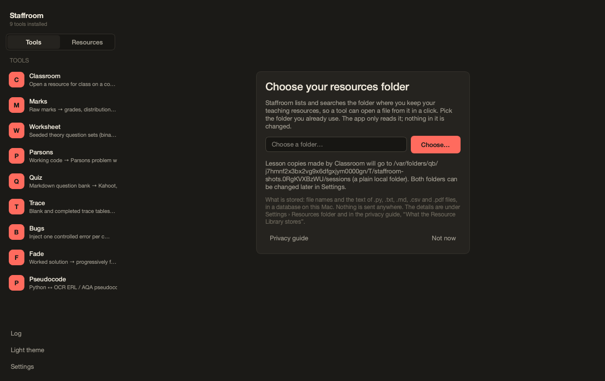

# Using the launcher

The window has two sidebar roots: **Tools** and **Resources**.

The tools are listed in the order a lesson meets them, not alphabetically:
Classroom, Marks, Worksheet, Parsons, Quiz, Trace, Bugs, Fade, Pseudocode.
A fresh install opens on Classroom. (`hello`, the developers' reference
tool, is not in the list; `staff hello` still works from the terminal.)

The very first start shows a card asking for the resources folder; choose
one or skip it and set it later in Settings.

Pick a tool, fill in its panel top to bottom, press the big button. Results
appear below the inputs and files are written to the output folder, which the
run bar names before you press Run: next to the input by default,
`~/TeachingSessions/outputs/<tool>/` for tools with no input file, or
wherever Settings says ([Outputs](outputs.md) has the rule and every tool's
file names). **Open output folder** works before and after the run. The log
at the bottom of each panel says exactly what happened in that run; the
log drawer (⌘L) and the log file hold the app-wide log, described in
[Privacy](privacy.md#what-the-log-contains).

## Shortcuts

| Keys | Does |
| --- | --- |
| ⌘K | Jump to the Resources search box |
| ⌘O | Classroom with the library picker open |
| ⌘1 – ⌘9 | Switch tool, top to bottom: ⌘1 Classroom, ⌘2 Marks, ⌘3 Worksheet, ⌘4 Parsons, ⌘5 Quiz, ⌘6 Trace, ⌘7 Bugs, ⌘8 Fade, ⌘9 Pseudocode |
| ⌘L | Show or hide the log drawer |
| ⌘, | Settings |

## Settings

| Setting | Meaning |
| --- | --- |
| Theme | dark or light |
| Output folder | where tools write; empty means next to the input, or `<sessions folder>/outputs/<tool>` when there is none or the input is in the resources folder |
| Resources folder | what the Resource Library indexes (read-only to every tool), and the folders under it to keep out of the index |
| Sessions folder | where Classroom puts lesson copies; local by default |
| Editor | Thonny, IDLE, system default, or a custom `{file}` command |
| Exam board | OCR J277 or AQA 8525: the grade preset Marks starts with, and the gates a GCSE truth-table worksheet may use |
| Header / footer text | printed on every worksheet and key |
| Logging | the level of the app log (`INFO` by default), and buttons to reveal the config file and the log |
| Updates | check for and apply an update when running from a checkout |

Everything is saved to `~/.config/staffroom/config.toml` as you change it.
Words the panels use without explaining (seed, facility, ERL, do-now…) are
in the [Glossary](glossary.md).

## The command line

Every tool is also a `staff` subcommand with the same options. `staff --help`
lists them; `staff <tool> --help` shows a tool's commands. The CLI is the
primary way the tools are tested, so if something works in the panel it
works in the terminal and vice versa.
