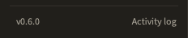
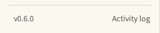

# Updating

## Installed with `uv tool install`

The install line pins a release tag, so `uv tool upgrade staffroom` has
nothing to move to and says *Nothing to upgrade*. To update, run the install
line again with the newer tag from the
[Releases](https://github.com/ColePoppleton/Staffroom/releases) page; uv
replaces the old version:

```bash
uv tool install --python 3.12 git+https://github.com/ColePoppleton/Staffroom@v0.8.0
```

(Swap the tag for the one you want. The same works to go back a version.)

## Which version am I running?

The foot of the sidebar shows it, for example `v0.6.0 · up to date` once the
app has checked for a release (just `v0.6.0` before, or when it cannot check).




Settings › Updates says the same at the top of the card. On a release tag it
is just the version (`Running Staffroom 0.5.0`); anywhere else it adds the
branch and the short commit (`Running Staffroom 0.5.0 (dev, a1b2c3d)`), which
is what to quote when reporting a problem. From the terminal:
`staffroom --version` or `staff version`.

The launcher app's Get Info in Finder shows the version it was built from.
`just install` rebuilds it; an update through the app or `staff update` does
not, so Get Info can lag behind the sidebar until the next `just install`.

## Running from a checkout (the macOS launcher app)

The app checks the git remote when it starts and compares your checkout with
the **released branch**, `origin/main`, whatever branch you happen to be on.
If a release is ahead, an **update** link appears beside the version at the
foot of the sidebar and opens Settings › Updates; Settings ›
Updates has *Check for updates* and *Update now*, and the status line names
the newest release tag (for example `v0.5.0`). Restart afterwards.

From the terminal the same thing is `staff update` (or `staff update --check` to
only look). It fast-forwards `main` and syncs dependencies. It never switches
branch, never overwrites local edits and never merges a diverged branch; it
tells you instead:

| Status line says | Meaning |
| --- | --- |
| `Up to date with origin/main (abc1234)` | Nothing to do. |
| `2 updates available (abc1234 → origin/main, v0.5.0)` | *Update now* fast-forwards. |
| `…; on dev; releases are on main` | The checkout is on another branch. The release is reported but not pulled; switch to `main` yourself if you want it. |
| `…; main has no upstream; comparing with origin/main` | The branch has no tracking ref. Harmless: the release branch is still compared and can be pulled. |
| `…; detached (not on a branch); releases are on main` | Detached HEAD. Reported, never pulled. |
| `abc1234 on main; no remote configured` | Nothing to compare with. |
| `Could not check: origin has no 'main' branch to update from` | The remote has no release branch of that name. |

If you release from a different branch, set it in `config.toml`:

```toml
[general]
release_branch = "main"
```

## Versions

Releases follow semantic versioning and are tagged `vX.Y.Z` on `main`; each
one is a GitHub Release with the changelog section as its notes. The full
history is in the [changelog](../changelog.md).
