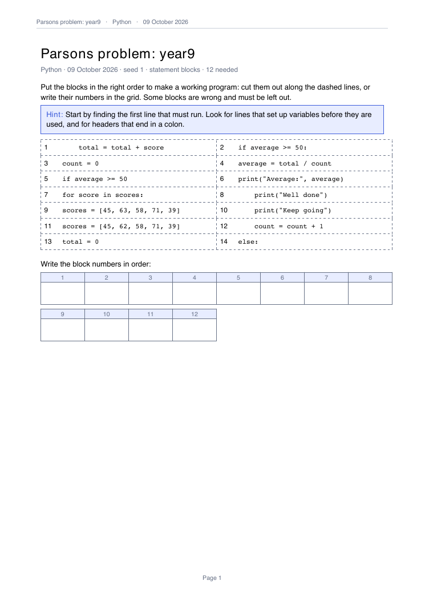
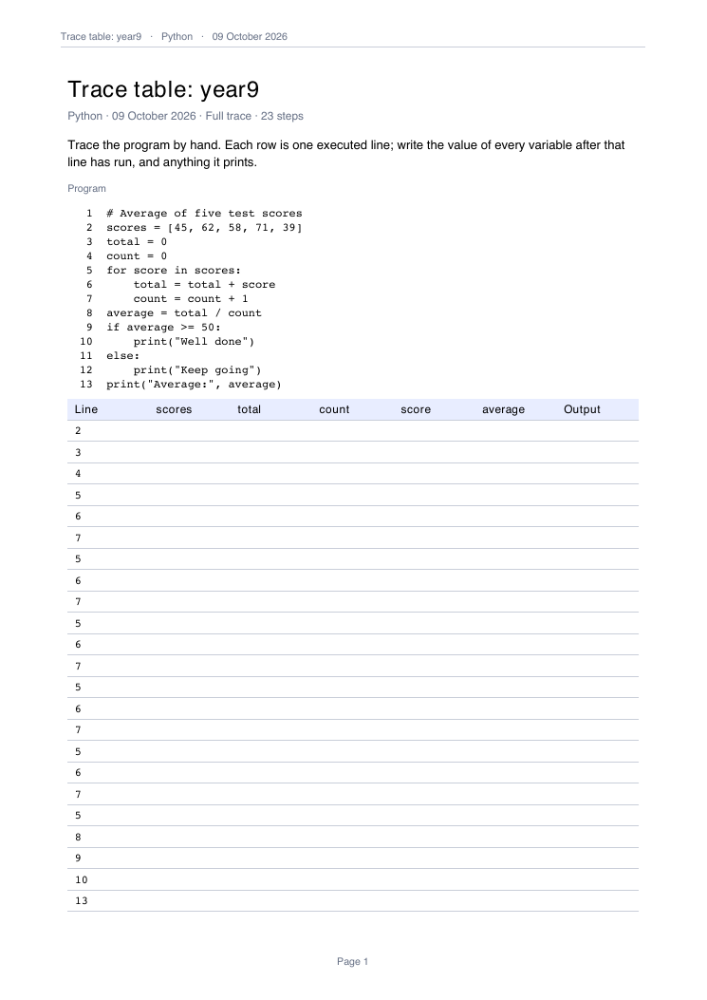
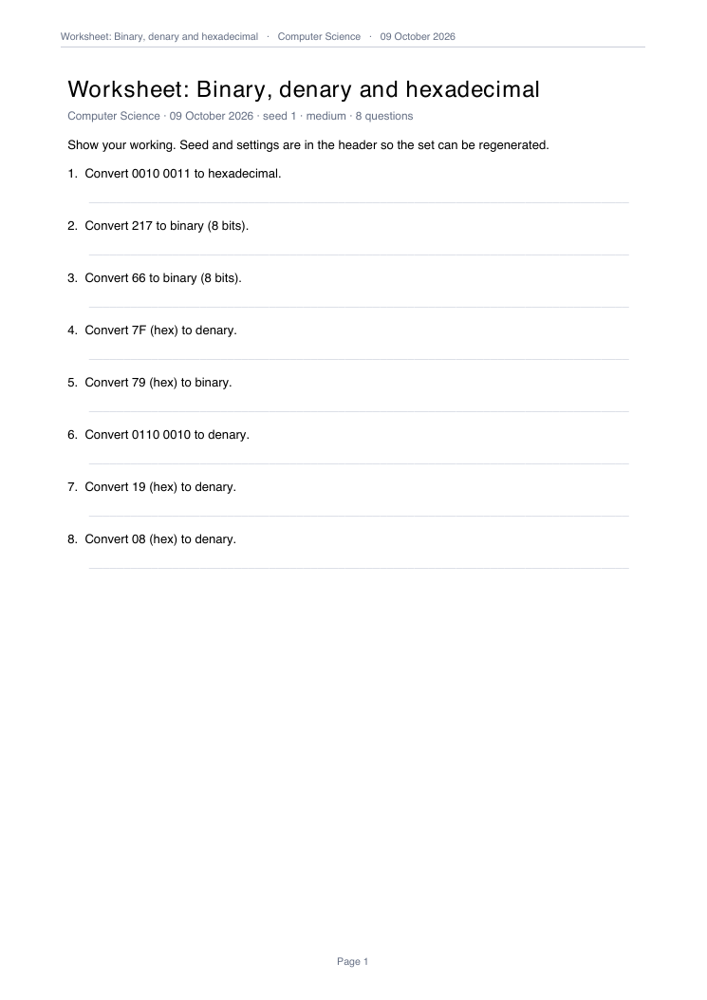
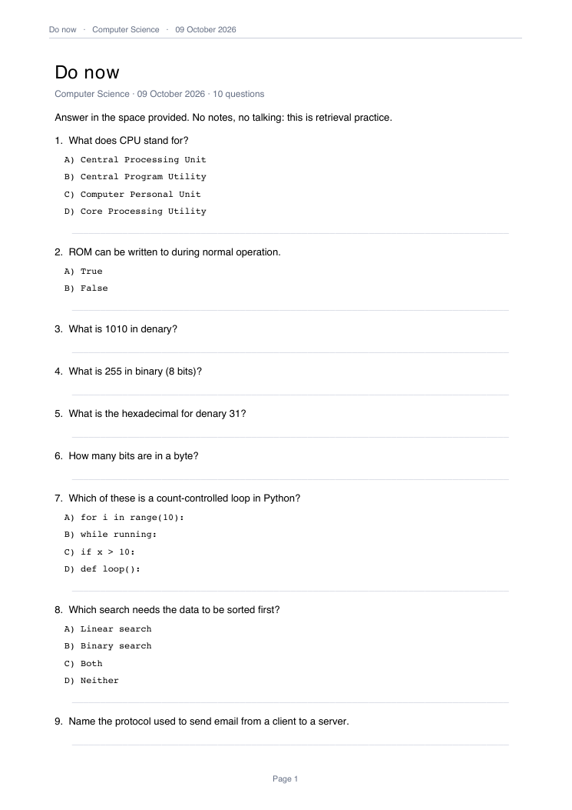
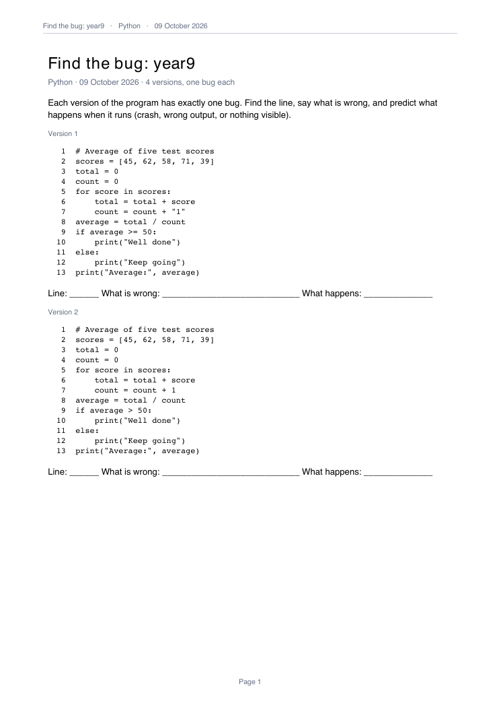
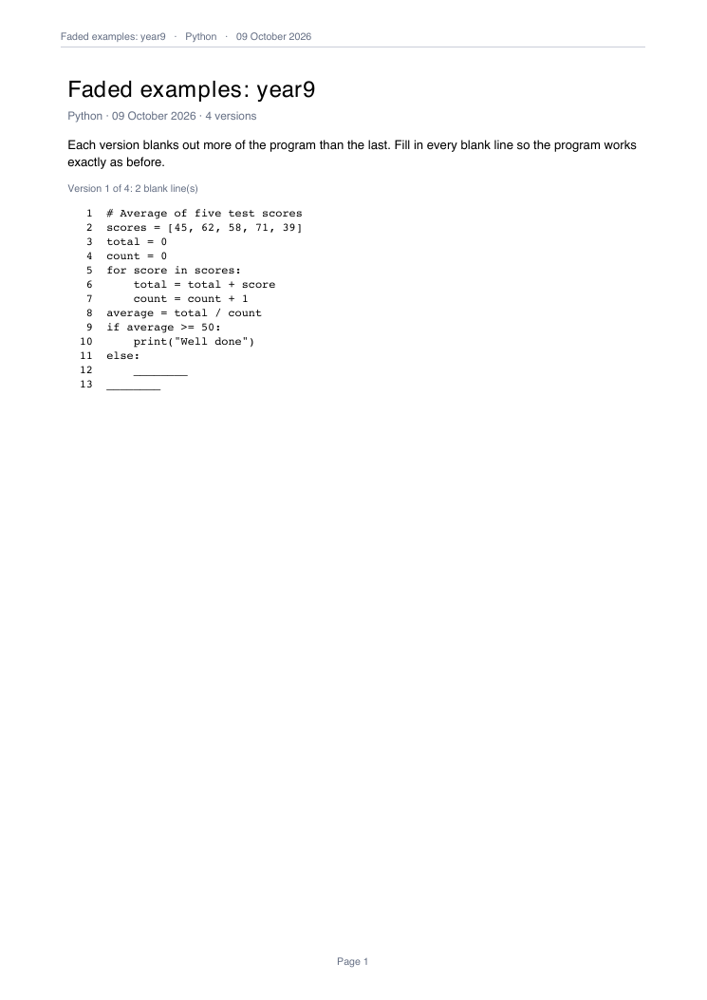

<!-- The home page. Layout classes (sr-*) live in docs/stylesheets/brand.css.
     Every image is a real output made by scripts/screenshots.sh, and every
     claim in the privacy strip is checked against guide/privacy.md by
     tests/test_docs_landing.py. -->

<div class="sr-hero" markdown>

<div class="sr-hero__text" markdown>

# Monday's worksheet,<br> <em>made on Sunday</em>. { .sr-headline }

Nine small tools for secondary computing teachers (KS3, GCSE, A-level): mark
a mock, make a Parsons problem, a trace table or a seeded binary sheet with
its key. They run on your own Mac, print in a plain house style, and take no
pupil data.
{ .sr-lede }

<div class="sr-cta" markdown>
[Install](guide/install.md){ .md-button .md-button--primary }
[See what it makes ↓](#what-comes-out){ .md-button }
</div>

<div class="sr-install" markdown>

<p class="sr-install__label">Two lines in Terminal (<a href="https://docs.astral.sh/uv/">uv</a> first)</p>

```bash
uv tool install --python 3.12 git+https://github.com/ColePoppleton/Staffroom@v0.6.0
staffroom
```

</div>

The repository is private for now, so the first line works only if your
GitHub account can see it. [Install](guide/install.md) has the details and
the alternatives.
{ .sr-install__note }

</div>

<div class="sr-fan" markdown>

{ .sr-page .sr-page--back }
{ .sr-page .sr-page--middle }
{ .sr-page .sr-page--front }

</div>

</div>

<div class="sr-privacy" markdown>

<div markdown>

<p class="sr-privacy__title"><span aria-hidden="true">✓</span> Stored, on this Mac only</p>

Your settings, an index of the files (and their text) in your resources
folder, run counts per tool and a log of file paths, under
`~/.config/staffroom/`; lesson copies and outputs in folders you choose.
[Every path is listed](guide/privacy.md#where-things-live).

</div>

<div markdown>

<p class="sr-privacy__title"><span aria-hidden="true">✕</span> Never stored</p>

A name, candidate number or row of marks from a marks file: identifier
columns are dropped on load and only class-level aggregates are saved. No
log holds a value from your files.
[What the filter catches](guide/privacy.md#what-the-identifier-filter-catches-and-what-it-does-not).

</div>

<div markdown>

<p class="sr-privacy__title"><span aria-hidden="true">⌕</span> Check it yourself</p>

No account and no server: the only network call is the update check, when
the app runs from a git checkout. Removing every trace is deleting a short
list of folders. [Which ones](guide/privacy.md#deleting-everything).

</div>

</div>

## What comes out { #what-comes-out }

Real first pages, made from the example files in the repository. Each sheet
comes with its answer key as a separate file, in PDF and Word.

<div class="sr-gallery" markdown>

<div class="sr-card" markdown>
[{ .sr-thumb }](tools/worksheet.md)

[Worksheet](tools/worksheet.md){ .sr-card__name }
Seeded binary, logic, file-size and compression questions; the seed is in
the header, so the same sheet comes back.
</div>

<div class="sr-card" markdown>
[{ .sr-thumb }](tools/quiz.md)

[Quiz](tools/quiz.md){ .sr-card__name }
One Markdown question bank: a printed do-now (shown), Kahoot or Forms.
</div>

<div class="sr-card" markdown>
[{ .sr-thumb }](tools/parsons.md)

[Parsons](tools/parsons.md){ .sr-card__name }
A working program cut into numbered blocks, with distractors and an answer
grid.
</div>

<div class="sr-card" markdown>
[{ .sr-thumb }](tools/trace.md)

[Trace](tools/trace.md){ .sr-card__name }
A blank trace table from a sandboxed run; the completed one is the key.
</div>

<div class="sr-card" markdown>
[{ .sr-thumb }](tools/bugs.md)

[Bugs](tools/bugs.md){ .sr-card__name }
One controlled error per copy; the key says whether each crashes, prints
the wrong thing or runs the same.
</div>

<div class="sr-card" markdown>
[{ .sr-thumb }](tools/fade.md)

[Fade](tools/fade.md){ .sr-card__name }
Worked examples with more of the program blanked out each time.
</div>

<div class="sr-card" markdown>
<div class="sr-thumb sr-thumb--code" markdown>

```text
--8<-- "output-pseudocode-ocr.txt"
```

</div>

[Pseudocode](tools/pseudocode.md){ .sr-card__name }
Python into OCR Exam Reference Language (shown) or AQA pseudocode, and
back, with a could-not-translate list.
</div>

<div class="sr-card" markdown>
[{ .sr-thumb .sr-thumb--chart }](tools/marks.md)

[Marks](tools/marks.md){ .sr-card__name }
Grades, the distribution and the questions to reteach from a mock. Only
class-level results are saved.
</div>

</div>

[Classroom](tools/classroom.md) and the [Resource Library](tools/library.md)
make no new pages: they open, copy and find the files you already have.
Every tool has a command-line twin (`staff <tool> ...`), so anything you can
click you can script. [Outputs](guide/outputs.md) says where every file goes
and what it is called; the [Glossary](guide/glossary.md) explains the words
the panels use.
</content>
