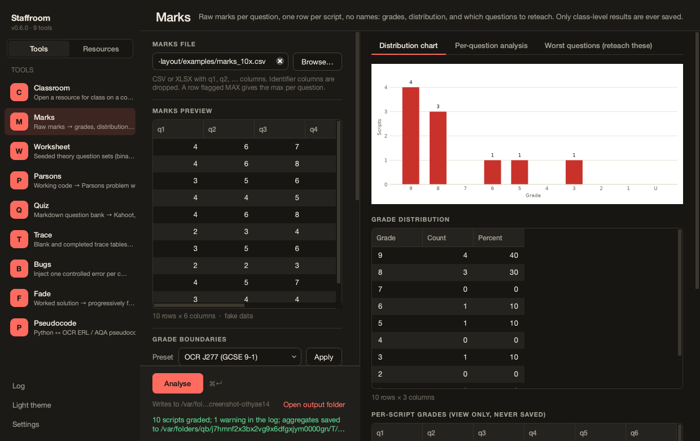

# Staffroom

Small tools for secondary computing teachers (KS3, GCSE, A-level), in one
desktop launcher. Mark a mock and see which questions to reteach, turn a
working program into a Parsons problem or a trace table, generate a seeded
binary worksheet with its key, export a quiz to Kahoot, and open a resource
for a lesson without ever overwriting the original.

**No pupil data, ever.** The tools take marks without names, resources
without classes, and logs of what was taught, not who was there. Nothing
saved can be traced to a pupil. See [Privacy](guide/privacy.md).



## What's in the box

| Tool | One line |
| --- | --- |
| [Classroom](tools/classroom.md) | Open a resource for class on a copy; diff and promote edits |
| [Marks](tools/marks.md) | Raw marks → grades, distribution chart, facility and discrimination |
| [Worksheet](tools/worksheet.md) | Seeded binary, logic, file-size and compression questions with keys |
| [Parsons](tools/parsons.md) | Working code → shuffle-the-blocks worksheet with distractors |
| [Trace](tools/trace.md) | Blank and completed trace tables from a sandboxed run |
| [Bugs](tools/bugs.md) | One controlled error per copy; the key says what each does |
| [Fade](tools/fade.md) | Progressively faded worked examples |
| [Pseudocode](tools/pseudocode.md) | Python ↔ OCR ERL ↔ AQA pseudocode, with a could-not-translate list |
| [Quiz](tools/quiz.md) | Markdown question bank → Kahoot, Forms text, printable do-now; retrieval scheduler |
| [Resource Library](tools/library.md) | Index, search, preview and tag your resources folder |

Every tool has a command-line twin (`staff <tool> ...`), so anything you can
click you can script.

## Install in one line

```bash
uv tool install staffroom
staffroom
```

Details and alternatives in [Install](guide/install.md).
