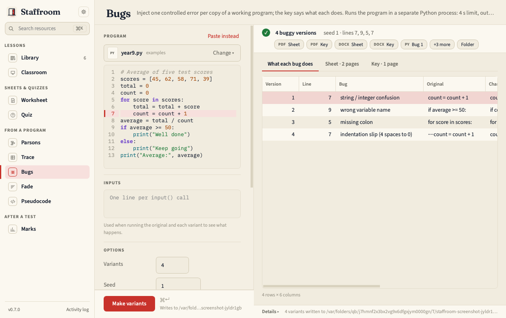

# Bugs

Inject one controlled error per copy of a working program. Pupils find the
line and predict what happens; the key knows, because each variant was run.



Error classes: comparison flipped, off by one, missing colon, missing
bracket, wrong variable name, indentation slip, string / integer confusion.
Each variant differs from the original by exactly one line, and the key says
*crashes: SyntaxError*, *runs, but the output is wrong*, *hangs*, or
*no visible change*.

The sheet puts two versions on each page, each with its *Line / What is
wrong / What happens* line underneath, so four versions print on two pages.

Each run has a 4 second limit and a 1 MB cap on output; a variant that
prints past the cap is marked *output capped*. The runs are not a security
sandbox: see [Running pupil code](../guide/running-code.md).

Files: one `<stem>_bug1.py` … `<stem>_bugN.py` per variant (so a variant can
be opened in Thonny as it is), then the sheet `<stem>_bugs.docx` / `.pdf`
and its `<stem>_bugs_key` ([Outputs](../guide/outputs.md)). If fewer
distinct one-line mutations exist than you asked for, you get fewer and the
run log says so.

```bash
staff bugs make program.py -n 4 --seed 1 --kinds missing_colon,off_by_one --stdin "Apple"
staff bugs kinds
```
