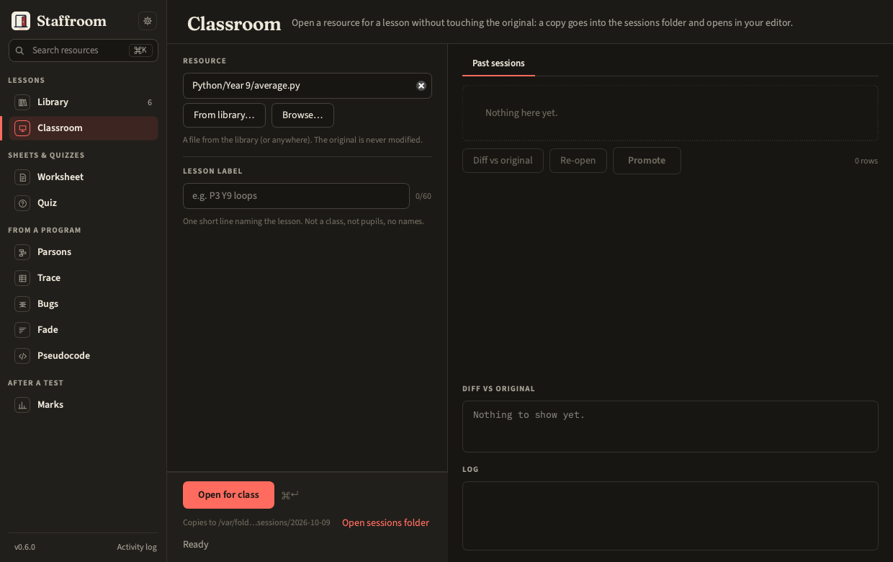

# Classroom

Open a resource for a lesson **on a copy**, never the original. The copy
goes to `<sessions folder>/<date>/<lesson label>/` and opens in your editor
(Thonny by default). Afterwards: see what you changed, re-open it, or
promote the edited version back beside the original as `name_v2.py`.



## In the panel

1. **Resource**: pick from the library (⌘O gets you here) or browse.
2. **Lesson label**: one short line, e.g. `P3 Y9 loops`. Not a class, not pupils.
3. **Open for class**.

**Past sessions** lists every copy. Select one for *Diff vs original*,
*Re-open* or *Promote* (copies back next to the original under a new
versioned name; never overwrites).

## On the command line

```bash
tt classroom open path/to/resource.py --label "P3 Y9 loops"
tt classroom list
tt classroom diff "2026-10-06/P3 Y9 loops/resource.py"
tt classroom promote "2026-10-06/P3 Y9 loops/resource.py"
tt classroom reopen "2026-10-06/P3 Y9 loops/resource.py"
```

## Settings that matter

Sessions folder (local by default), Editor command (`{file}` is replaced by
the copy's path).
