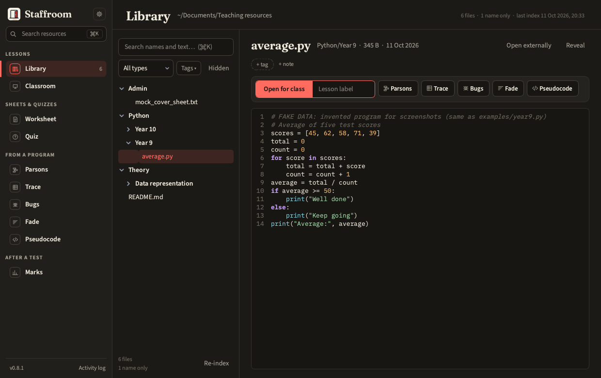
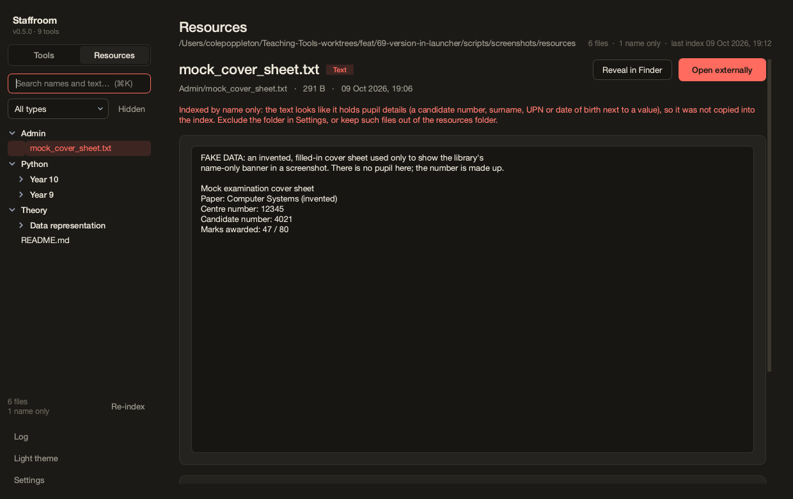
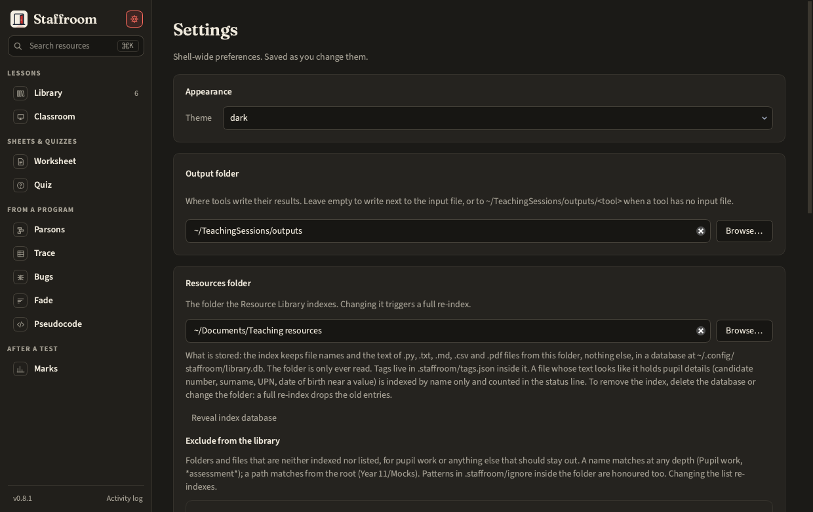

# Resource Library

The **Resources** root in the sidebar indexes your resources folder: a
searchable tree with previews, and tags and notes kept in a sidecar file so
the resources themselves are never written.



- Search covers file names and the text of `.py`, `.txt`, `.md`, `.csv` and
  `.pdf` files. Office files (`.doc`, `.docx`, `.ppt`, `.pptx`, `.pub`,
  `.xlsx`) are **never parsed**; they open in their native app.
- Previews: Python with highlighting, plain text, images, the first page of
  a PDF, or an open-externally card.
- Cloud placeholders (files not downloaded on this Mac) are marked, not fatal.
- Re-index is incremental; the first index of a few hundred files takes seconds.

Tools reach the library through a picker: ⌘O, or *From library…* on any
file input.

## Keeping things out

The index copies the text of searchable files into `~/.config/staffroom/library.db`,
so pupil work should not be under the resources folder at all. Two guards help:

- **Exclusion list** (*Settings › Resources folder*, or `staff library exclude`).
  A name matches at any depth, with `*` and `?` wildcards (`Pupil work`,
  `*assessment*`, `*.bak`); a path matches from the root (`Year 11/Mocks`,
  `*/submissions`). The same patterns, one per line, may live in
  `<root>/.staffroom/ignore` for a folder shared between machines; the app
  reads that file and never writes it. Excluded paths are neither indexed nor
  listed, and changing the list re-indexes.
- **Name only.** A file whose text looks like it holds pupil details (a
  candidate number, surname, UPN or date of birth next to a value) is indexed
  by name only. The index summary, the sidebar status and
  `staff library status` show the count; the preview carries a banner. This is
  a warning to act on, not a filter to rely on.



Exactly what the index holds, where it lives and how to delete it is in
[Privacy](../guide/privacy.md#what-the-resource-library-stores).



```bash
staff library index
staff library search while --kind python
staff library tags "Python/loops.py" --set loops,ks3 --notes "Good starter"
staff library exclude --add "Pupil work" --add "Year 11/Mocks"
staff library status
```
