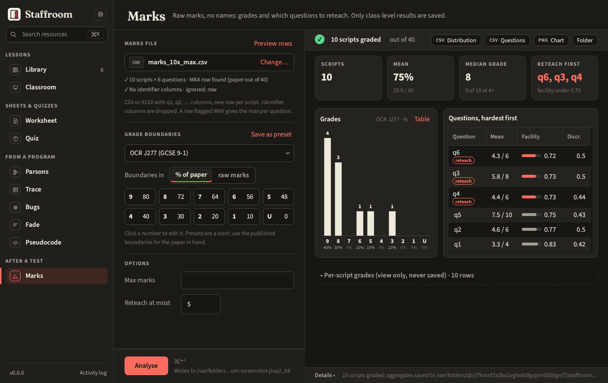
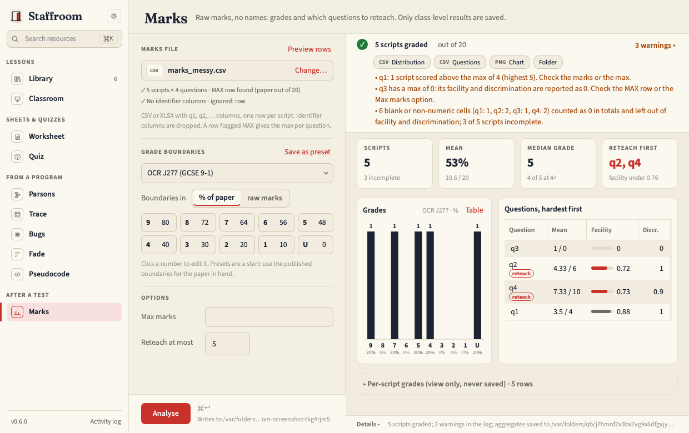
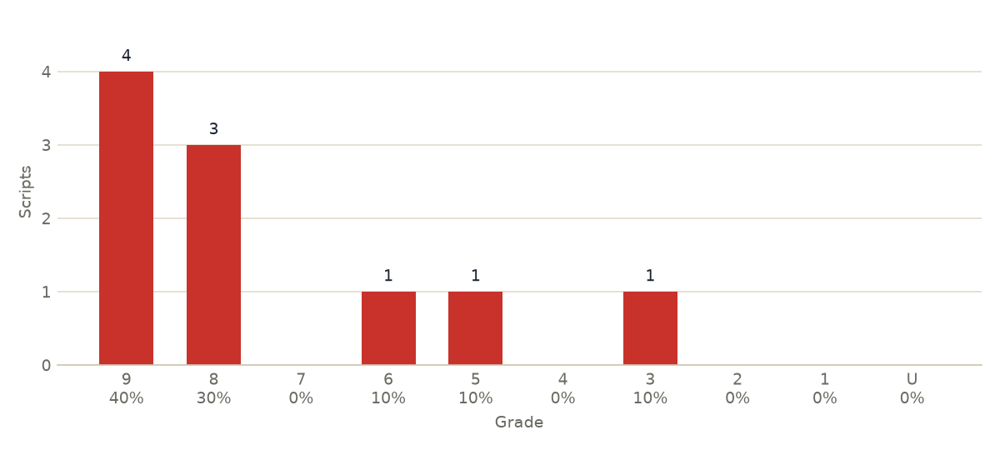

# Marks

Raw marks per question, one row per script, **no names** → a one-screen
report: how the class did and which questions to reteach. Only class-level
aggregates are ever saved.



After *Analyse* the report reads top to bottom:

- **Four headline tiles.** *Scripts*; *Mean* as a percentage of the paper
  (with the mean mark out of the total); *Median grade*, the grade of the
  median total, with how many scripts reached grade 4 (or, for boundaries
  without a 4, the lowest grade above zero: E for A-level, Pass for
  Pass/Fail); and *Reteach first*.
- **The grade chart**, with the count over each bar and the share of scripts
  under it. *Table* flips it to the numbers (to one decimal place, and the
  *Incomplete scripts* row when there is one).
- **Questions, hardest first**: one table sorted by facility, lowest first,
  with the mean out of the max, an inline facility bar and discrimination.
  The questions to reteach are tagged *reteach*: the lowest-facility
  questions the class did worse on than on the paper as a whole, at most
  *Reteach at most* of them (5 by default). A question's note (*hard*,
  *easy*, *weak discriminator*) is in its tooltip and in the saved CSV.
- **Per-script grades**, folded under one line that says *view only, never
  saved*. Open it to check a script; it is never written to a file.

## Input file

A CSV or XLSX with question columns `q1`, `q2`, … (see
[Marks files](../guide/marks-files.md)). Once chosen, the file shows as a
chip with what was found in it: how many scripts and questions, whether a
`MAX` row gives the paper total, and which columns were dropped as
identifiers or ignored. *Preview rows* opens the rows themselves. Max marks come from a row flagged
`MAX` (the word can be in any cell, including a name column that is about
to be dropped), from the *Max marks* option, or, with a warning, from the
highest mark seen. Identifier columns are dropped on load; what that catches
and what it does not is in [Privacy](../guide/privacy.md#what-the-identifier-filter-catches-and-what-it-does-not).

## Warnings

The run log warns, before you trust the numbers, when:

- a question has a max of 0 (its facility and discrimination are reported
  as 0: check the `MAX` row or the *Max marks* option);
- a script scored above a question's max;
- cells are blank or non-numeric (`ab` for absent, `-`, an empty cell). They count as
  0 in that script's total and grade and are left out of facility and
  discrimination, and the distribution table gains a last row,
  **Incomplete scripts**, saying how many scripts were affected. The chart
  leaves that row out;
- a grade boundary is above the paper total, which is what a percent preset
  applied with the unit set to raw marks looks like.

Nothing in the list stops the run. `examples/marks_messy.csv` makes every
warning fire if you want to see them.

The result strip counts them ("3 warnings ▸"); click the count for the list.
Each is also in the run log under *Details*.



## Boundaries

A compact grid of grade and minimum, five to a line: click a number to edit
it. *Boundaries in* switches between percent of the paper and raw marks.
Built-in presets for OCR J277, AQA 8525 and A-level are starting points:
choose one, edit it to the published boundaries and *Save as preset*.

## Outputs

| On screen | Saved |
| --- | --- |
| Headline tiles | never (worked out again on every run) |
| Grade chart (and its table) | `<stem>_distribution.csv` and `.png` |
| Questions, hardest first, reteach tagged | `<stem>_questions.csv` (in paper order) |
| Per-script grades (folded, view only) | never |

The chart is drawn for paper and slides, white background whatever theme
the launcher is using, so it can go straight into a report.



Facility is the mean mark as a fraction of the max; discrimination is the
difference between the top and bottom third's mean, over the max. Both are
spelled out in the [Glossary](../guide/glossary.md#assessment). Files go
next to the input unless Settings says otherwise ([Outputs](../guide/outputs.md)).

```bash
staff marks run marks.csv --preset "OCR J277 (GCSE 9-1)" --unit percent --max 4,6,8,6,10,6
staff marks presets
```

The command line prints the same report: the four headline numbers, the
grade distribution and the questions hardest first (`--worst N` sets
*Reteach at most*).
