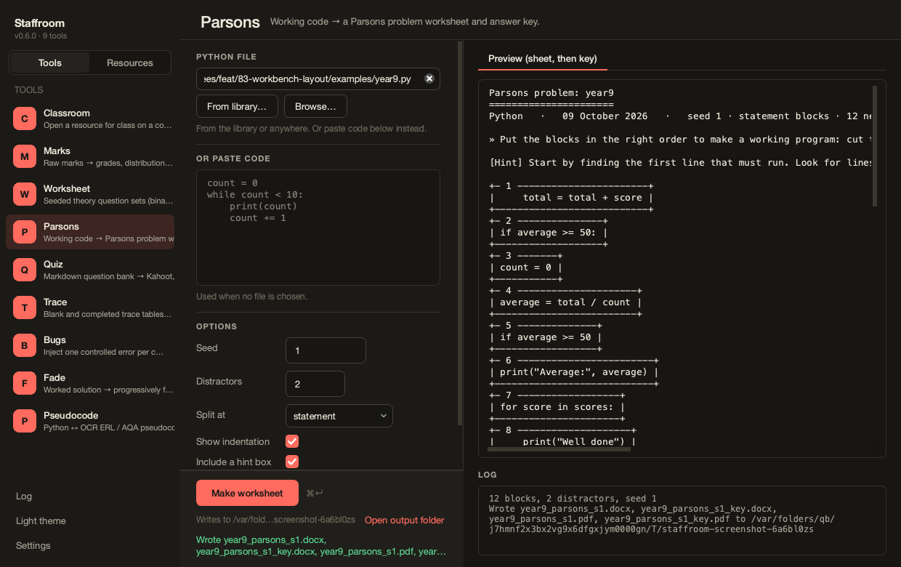

# Parsons

A working program → a worksheet of shuffled blocks to put back in order,
with optional distractors, and a key.



- **Split at** statement (compound headers and their bodies become separate
  blocks, so structure is rebuilt too) or line.
- **Distractors** are real lines with a colon removed, a comparison flipped
  or a number off by one. The key says which blocks to leave out.
- **Show indentation** off makes pupils decide the indents.
- The key reconstructs the program; the tests prove it is equivalent to the input.

```bash
staff parsons make program.py --seed 7 --distractors 2 [--lines] [--no-indent]
```
