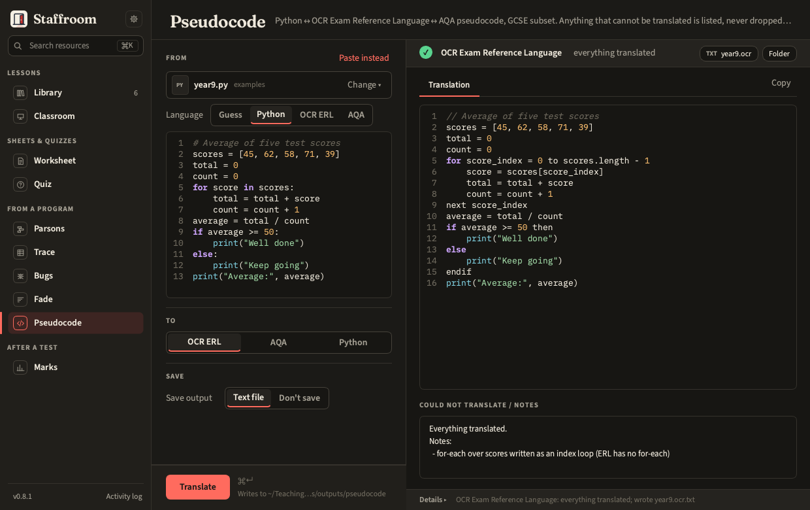

# Pseudocode

Python ↔ OCR Exam Reference Language ↔ AQA pseudocode, for the GCSE subset.
Anything that cannot be translated is kept as a comment in the output and
listed; nothing is dropped silently.



The subset: variables, arithmetic (`DIV`, `MOD`, `^`), comparisons,
`AND/OR/NOT`, if/elif/else, count loops, for-each, while, `do…until`,
functions and procedures, lists and indexing, string length / substring /
upper / lower, casts, random, basic file methods, comments.

```bash
tt pseudocode to-ocr program.py
tt pseudocode to-aqa program.py --save --out ./out
tt pseudocode to-python sheet.ocr.txt
```
