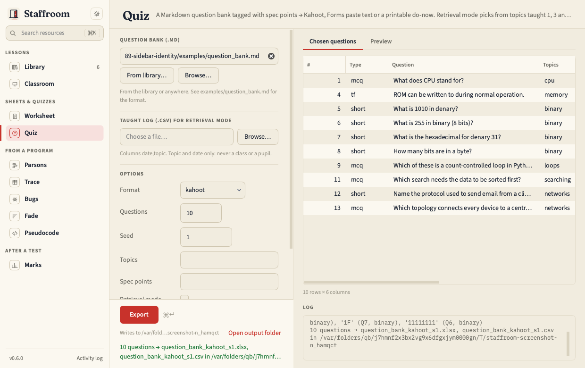

# Quiz

Write questions once in a Markdown bank tagged with spec points and topics;
export to Kahoot, to text for a Forms quiz, or to a printable do-now with a
separate key. Retrieval mode picks from topics taught one, three and six
weeks ago.



See [Question banks](../guide/question-banks.md) for the file format.

| Format | Produces |
| --- | --- |
| kahoot | `.xlsx` in Kahoot's template layout plus a `.csv` with the same headers |
| forms | numbered text with lettered options and a separate answers block |
| donow | house-style docx and PDF with the key split off |

Files are named after the bank: `<bank>_kahoot.xlsx` and `.csv`,
`<bank>_forms.txt`, `<bank>_donow.docx` / `.pdf` and `<bank>_donow_key`
([Outputs](../guide/outputs.md)). Retrieval mode looks at the topics taught
one, three and six weeks ago, each with three days' leeway, and draws
questions round-robin across the three windows; the run log lists what fell
in each. *Do-now*, *spec point* and *retrieval windows* are in the
[Glossary](../guide/glossary.md#quiz).

```bash
staff quiz export --bank bank.md --format kahoot --topics binary,cpu --n 10
staff quiz retrieval --bank bank.md --log taught.csv --date 2026-10-08
staff quiz check --bank bank.md
staff quiz spec ocr
```

!!! note
    The Kahoot import is checked by hand against Kahoot's template columns.
    If Kahoot changes its template, `staff quiz check` will not notice.
