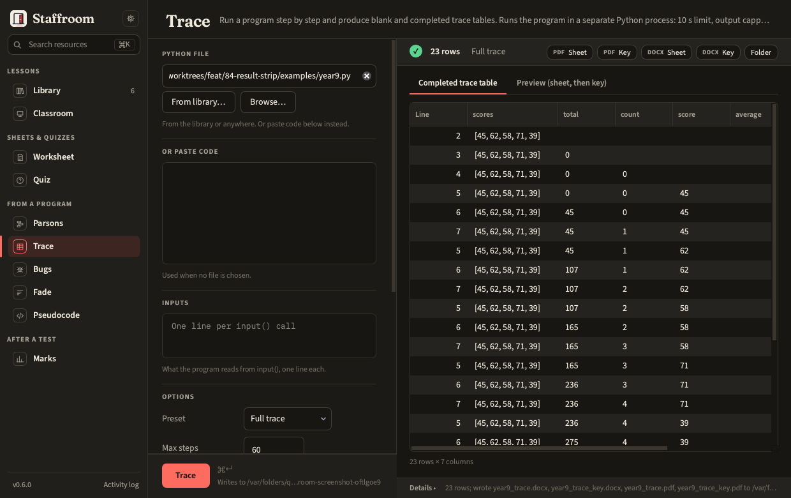
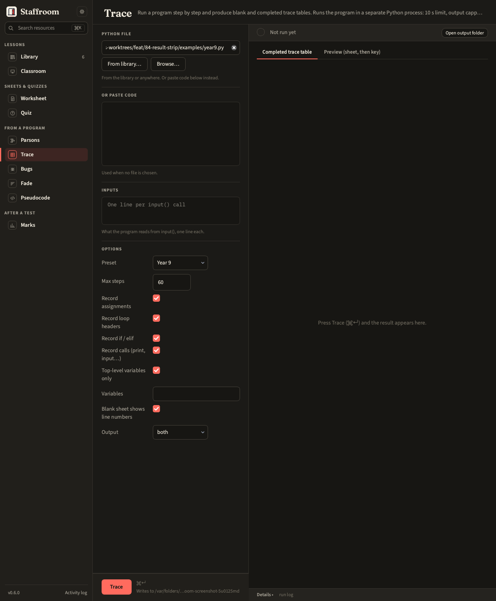
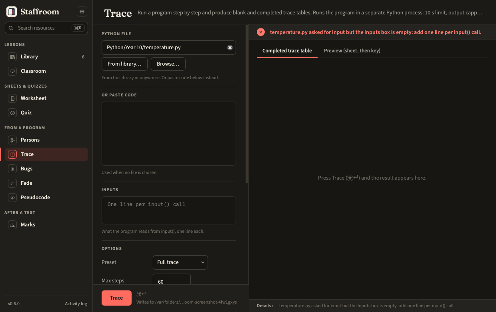

# Trace

Runs a program step by step in a sandbox and produces a blank trace table
for pupils and a completed one for you.



Each row is one executed line with every variable's value **after** that
line and anything it printed. The *Preset* dropdown picks the shape of the
table: **Full trace** (the default) records every line, including those run
inside functions, with a *Scope* column naming the function and a column for
each of its locals; **Year 9** (*Top-level variables only*, or
`--top-level-only`) leaves the function's own steps and locals out, so the
sheet has just the program's top-level variables and no Scope column. The
header of every sheet names the preset it came from; a table whose settings
match neither says *Custom*. You can still choose which lines to record
(assignments, loop headers, ifs, calls) and which variables to show
(*Variables*, or `--vars`). *Max steps* (60 by default) caps the rows and the
sheet says when it was hit.



Programs that read input take it from
the *Inputs* box, one line per `input()`. If the program asks for more
input than the box holds, the run stops with a message that says so and
nothing is written: fill in the box and run again. A program that ends with
any other error still gets its sheet; the key and the result strip say which
error.



Files: `<stem>_trace.docx` / `.pdf` is the blank table, `<stem>_trace_key`
the completed one ([Outputs](../guide/outputs.md)).

The program runs in a separate Python process with a 10 second limit, a
temporary working folder, a 1 MB cap on what it prints and a refusal to run
files that import networking modules. An infinite loop is killed and
reported; a print flood is cut at the cap and the key says so. This is not
a security sandbox: see [Running pupil code](../guide/running-code.md).

```bash
staff trace make program.py --stdin "5\n3" --steps 60 --vars total,count
staff trace make program.py --top-level-only   # the Year 9 preset
```
