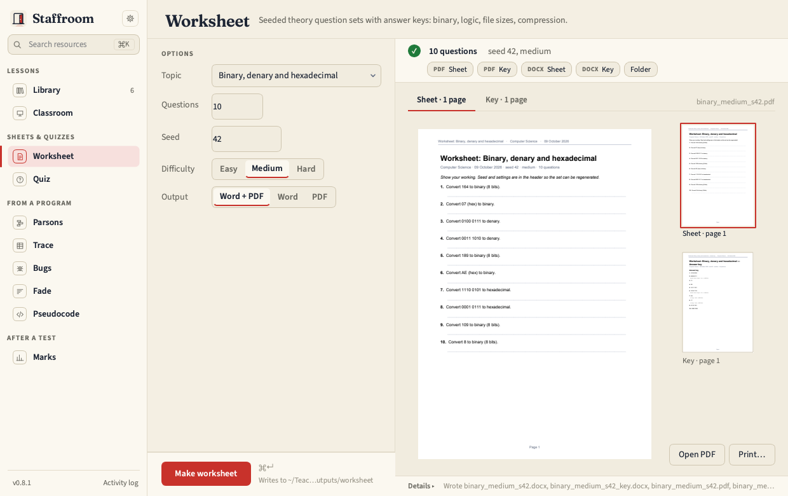
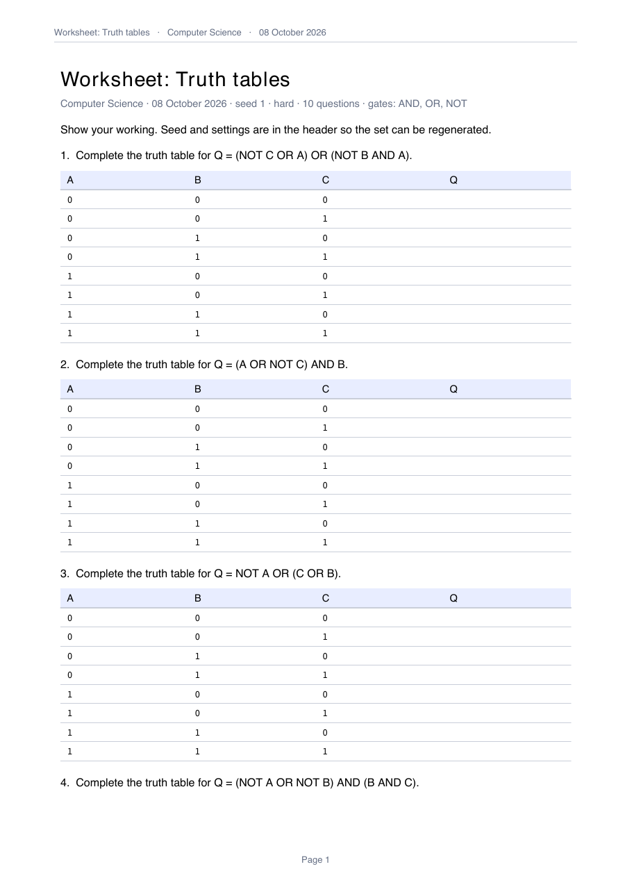

# Worksheet

Seeded sets of theory questions with answer keys. The seed, difficulty and
count are printed in the header so a set can be regenerated.



## Topics

| Topic | What it asks |
| --- | --- |
| binary | denary ↔ binary ↔ hex (4, 8 or 12 bits by difficulty) |
| twos_complement | 8-bit two's complement both ways |
| binary_addition | 8-bit addition with the overflow flag |
| shifts | logical and arithmetic shifts and their effect |
| truth_tables | 2 or 3 inputs; the gates follow the board and level (below) |
| boolean_simplification | with each law written in the question's own letters in the key |
| file_size | image, sound and text calculations |
| rle | run-length encode and decode |
| huffman | total bits for a small frequency table |

Every generator is verified in the tests by independent computation.

## Logic questions

Truth tables use the gates the exam board requires: OCR J277 is AND, OR and
NOT; AQA 8525 adds XOR. Neither GCSE board has NAND or NOR, so those appear
only when **Level** is `a_level` *and* the difficulty is `hard` (A-level also
adds XOR at every difficulty). The board comes from Settings (`general.board`)
or `--board`. Every question uses all of the inputs its table lists, no gate is
fed the same input twice, and Q is never constant or simply one input.

Boolean simplification builds each question by wrapping one letter at a time
in a law's longer form, so the key can undo the wraps in order, each step in
the question's own letters: `absorption: B AND (B OR NOT C) = B, leaving
A AND B`. **Boolean laws** chooses what is practised: `absorption` (absorption,
distributive and complement; the default), `de_morgan` (adds De Morgan),
`identities` (identity, idempotent, double negation, complement; the only
family that puts `X AND X`, `NOT NOT X` or `0`/`1` on the sheet) or `all`.

The header names the gate set or the law family next to the seed, so a sheet
describes the settings that regenerate it; an A-level sheet also gets `alevel`
in its file name so it never overwrites the GCSE sheet with the same seed.



```bash
staff worksheet make --topic binary --count 20 --seed 42 --difficulty medium
staff worksheet make --topic truth_tables --difficulty hard --level a_level --board aqa
staff worksheet make --topic boolean_simplification --laws de_morgan
staff worksheet topics
```

Output: `<topic>_<difficulty>_s<seed>.docx/.pdf` plus a `_key` file, in the
[house style](../guide/house-style.md).
