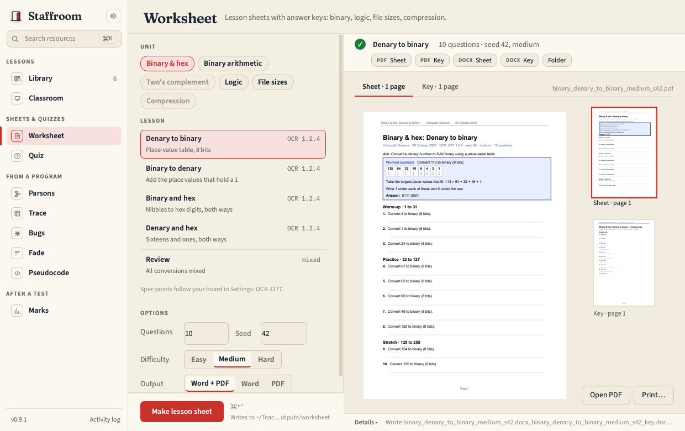
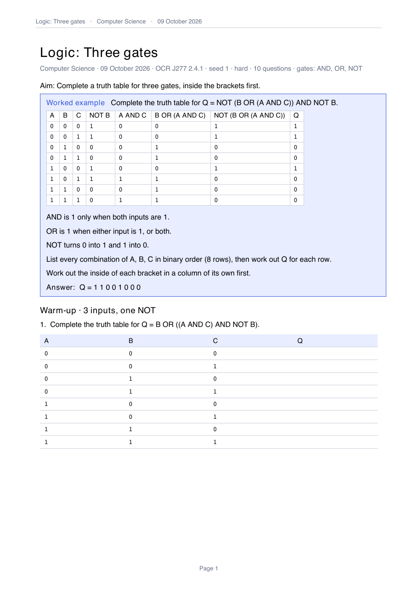

# Worksheet

One sheet for one lesson. Choose a **Unit** (*Binary & hex*), then a
**Lesson** in it (*Denary to binary*): the sheet practises that one skill.
It opens with a one-line aim and a **worked example** solved in full (with a
place-value table, a column addition or a truth table where one helps), then
climbs through **Warm-up**, **Practice** and **Stretch**. **Difficulty** sets
the size of the numbers; the climb happens inside every sheet. The key gives
the answer and the working for every question.

The header names your board's spec point, then the seed, difficulty and
count, so a sheet can be made again. A count outside 1–60 is refused with a
sentence rather than writing an empty sheet.



## Units and lessons

Each lesson shows your board's spec point beside it. A lesson your board does
not have stays choosable but greyed, saying whose it is (*On Edexcel only*),
so a stretch group or an A-level class can still use it.

| Unit | Lesson | OCR J277 | AQA 8525 | Pearson Edexcel 1CP2 |
| --- | --- | --- | --- | --- |
| Binary & hex | Denary to binary | 1.2.4 | 3.3.2 | 2.1.3 |
| | Binary to denary | 1.2.4 | 3.3.2 | 2.1.3 |
| | Binary and hex | 1.2.4 | 3.3.2 | 2.1.6 |
| | Denary and hex | 1.2.4 | 3.3.2 | — |
| | Review | mixed | mixed | mixed |
| Binary arithmetic | Binary addition | 1.2.4 | 3.3.4 | 2.1.4 |
| | Overflow | 1.2.4 | — | 2.1.5 |
| | Logical shifts | 1.2.4 | 3.3.4 | 2.1.4 |
| | Arithmetic shifts | — | — | 2.1.4 |
| | Review: addition, Review: shifts | mixed | mixed | mixed |
| Two's complement | Denary to two's complement | — | — | 2.1.3 |
| | Two's complement to denary | — | — | 2.1.3 |
| | Review | — | — | mixed |
| Logic | One gate, Two gates, Three gates | 2.4.1 | 3.4.2 | 1.3.1 |
| | Simplification | A level | A level | A level |
| | Review: truth tables | mixed | mixed | mixed |
| | Review: simplification | A level | A level | A level |
| File sizes | Image file size | 1.2.3 | 3.3.6 | 2.3.1 |
| | Sound file size | 1.2.3 | 3.3.7 | 2.3.1 |
| | Text file size | 1.2.3 | 3.3.8 | 2.3.1 |
| | Review | mixed | mixed | mixed |
| Compression | RLE: encode, RLE: decode | — | 3.3.8 | — |
| | Huffman coding | — | 3.3.8 | — |
| | Review: RLE, Review: Huffman | — | mixed | — |

Each point was checked against the board's published specification (the
same codes as `core/spec/*.toml`), and a test holds the table above. Where a
point was a judgement: OCR J277 1.2.5 leaves out carrying out compression
algorithms, and Edexcel 2.3.2 names lossless and lossy compression but no
method, so RLE and Huffman are AQA's; AQA 3.3.4 says answers never carry
beyond the 8th bit and only logical shifts are used, so Overflow and
Arithmetic shifts are not AQA's; Edexcel 2.1.6 converts hex to and from
binary only. Image, sound and text sizes are OCR J277 1.2.3, where the
formulas sit; AQA's text size is the uncompressed-ASCII count in 3.3.8.

File sizes follow the board's units: Pearson Edexcel 1CP2 measures in
kibibytes (1 KiB = 1,024 bytes, 2.3.1); OCR J277 and AQA 8525 in thousands
(1 KB = 1,000 bytes).

## Review sheets

The last lessons of a unit are its **Review** sheets: the mixed sheets the
tool made before it had lessons, with no worked example or sections. They
are exactly those sheets: the same seed, difficulty and count make the same
questions, the same key and the same file name
(`<topic>_<difficulty>_s<seed>`), so a seed printed on an old sheet still
works. A unit that held two old topics has a Review for each (*Review:
shifts*, *Review: Huffman*).

## Logic lessons

Truth tables use the gates the exam board requires: OCR J277 and Pearson
Edexcel 1CP2 are AND, OR and NOT (Edexcel 1.3.1: up to three inputs); AQA
8525 adds XOR. No GCSE board has NAND or NOR, so those appear only when
**Gates** is *A level* (`--level a_level`) *and* **Difficulty** is *Hard*
(A-level also adds XOR at every difficulty). The board comes from Settings
(`general.board`) or `--board`. Every question uses all of the inputs its
table lists, no gate is fed the same input twice, and Q is never constant or
simply one input. *One gate* is one gate on two inputs, *Two gates*
`(A AND B) OR C` on three, *Three gates* adds brackets and a NOT over a
bracket; each sheet adds NOTs as it climbs. The key lists the column of
every bracket on the way to Q.

Boolean simplification is A level on every board. It builds each question
from textbook forms: a law wraps one letter (or `NOT` letter), or one small
gate, in its longer form — absorption `A OR (A AND C)`, the distributive pair
`(A AND B) OR (A AND NOT B)`, the redundancy form `A AND (NOT A OR B)`, De
Morgan `NOT (NOT A OR NOT B)` — and the key undoes the wraps in order, each
step in the question's own letters: `absorption: B AND (B OR NOT C) = B,
leaving A AND B`. The lesson climbs from one step to three; a question stays
the size of an exam one. **Boolean laws** chooses what is practised:
*Absorption* (`absorption`: absorption, distributive and complement; the
default), *+ De Morgan* (`de_morgan`), *Identities* (`identities`: identity,
idempotent, double negation, complement; the only family that puts
`X AND X`, `NOT NOT X` or `0`/`1` on the sheet) or *All* (`all`). The panel
shows **Gates** only for truth-table lessons and **Boolean laws** only for
simplification.

The header names the gate set or the law family next to the seed, so a sheet
describes the settings that make it again; an A-level sheet also gets
`alevel` in its file name so it never overwrites the GCSE sheet with the
same seed.



## Command line

```bash
staff worksheet lessons                       # every unit and lesson, with your board's points
staff worksheet make binary --lesson denary-to-binary --count 10 --seed 42
staff worksheet make logic --lesson two-gates --difficulty hard --board aqa
staff worksheet make logic --lesson simplification --laws de_morgan
staff worksheet make binary                   # a unit on its own: its Review sheet
staff worksheet make --topic truth_tables     # an old topic name: its Review, unchanged
```

`staff worksheet topics` still works and lists the same. Old topic names
(`binary`, `twos_complement`, `binary_addition`, `shifts`, `truth_tables`,
`boolean_simplification`, `file_size`, `rle`, `huffman`) each make their
Review sheet.

Output: `<unit>_<lesson>_<difficulty>_s<seed>.docx/.pdf` (a Review keeps
`<topic>_<difficulty>_s<seed>`) plus a `_key` file, in the
[house style](../guide/house-style.md), in `~/TeachingSessions/outputs/worksheet/`
unless Settings names an output folder ([Outputs](../guide/outputs.md)).
*Seed*, *Gates*, *Boolean laws* and *Review* are in the [Glossary](../guide/glossary.md).
